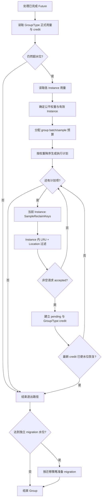

# CacheReclaimer 跨 Instance 公平逐出设计

| 项目 | 内容 |
|---|---|
| 状态 | V1 已实现，待评审与合入 |
| 更新时间 | 2026-07-23 |
| 涉及模块 | `manager`、`meta`、`config`、`metrics`、`service`、`protocol` |
| 关联需求 | 同 Group 内不同 Instance 间的公平逐出 |
| 历史参考 | [PR #183](https://github.com/alibaba/tair-kvcache/pull/183) |

本文档定义 CacheReclaimer 跨 Instance 公平逐出 V1 的行为契约和实现边界。PR #183 只作为历史方案参考；最终行为以本文档和主干实现为准。

## 1. 背景

### 1.1 当前逐出方式

CacheReclaimer 以 Instance Group 为水位和配额边界。当 Group 总用量、总 key count 或某个 Storage Type 的用量达到回收阈值时，Reclaimer 遍历 Group 内的 Instance，并对每个 Instance 使用相同的配置：

```text
sampling_size = kvcm.cache_reclaimer.key_sampling_size_total
batch_size = kvcm.cache_reclaimer.del_batch_size
```

对单个 Instance 的处理流程为：

```text
SampleReclaimKeys(sampling_size)
  -> 获取候选的 LRU 属性
  -> 在当前 Instance 内按 LRU 排序
  -> 选择最多 batch_size 个 key
  -> 过滤可删除 Location
  -> SubmitAsync
```

如果一轮中有 `N` 个非空 Instance 实际进入逐出，理论上的总采样量和总逐出上限分别为：

```text
group_sample_budget = sampling_size * N
group_batch_budget = batch_size * N
```

当前实现没有根据 Instance 的实际数据量调整这两个预算。一个只占 Group 极少容量的 Instance，可能与占用绝大部分容量的 Instance 获得相同的采样量和逐出上限。异步删除 credit 又可能在遍历前几个 Instance 后使水位恢复，因此固定遍历顺序还会进一步影响实际由谁承担逐出。

### 1.2 问题

上述行为主要有两个问题：

1. **逐出责任与用量贡献不匹配**：小 Instance 可能与大 Instance 承担相同数量的逐出，甚至因遍历顺序长期被优先处理。
2. **采样资源分配不匹配**：实际只需逐出少量 key 的 Instance 仍会采样固定数量的候选；需要较大 batch 的 Instance 又可能因候选不足无法完成计划。

典型场景是同一 Group 内一个 Instance 占用数十 TB，另一个低流量 Instance 只有数十 GB。固定批次会使低流量 Instance 的容量长期被压制在接近 0，同时大 Instance 对超水位的主要贡献没有得到对应的逐出责任。

### 1.3 V1 的公平定义

V1 将“公平”定义为：

> 当 Instance Group 超水位时，各 Instance 的计划采样量和计划逐出量，按照其在当前超水位维度上的数据量占比分配。

V1 只调整逐出责任，不保证每个 Instance 的最低保有容量。低流量 Instance 的最小容量、保底份额、业务权重或独立配额属于后续能力。

公平性作用于计划阶段。由于异步 credit 可能在计划执行中提前使水位恢复，某些 Instance 的计划不会执行；因此 V1 保证“大用量 Instance 优先承担逐出”，不承诺每一轮实际删除结果严格等于计划比例。

更准确地说，V1 采用“按用量比例生成理论计划、按大用量优先执行、由 Group/Type credit 提前截断”的策略。它不是根据目标水位计算各 Instance 超额用量的严格 water-fill；实际结果可能近似为只从最大 Instance 逐出。

所有候选生成、LRU 排序、Location 过滤和删除操作仍保持严格的 `instance_id` 隔离。

### 1.4 与历史 PR 和异步删除的关系

PR #183 首次实现了按绝对用量分配 per-instance batch，但存在以下不适合直接合入当前主干的差异：

1. 只调整 `batch_size`，每个 Instance 仍使用固定 `sampling_size`。
2. Group 总预算按全部 Instance 数计算，零用量 Instance 也会放大其他 Instance 的预算。
3. 非零权重取整为 0 时强制逐出 1 个 key，可能让极小 Instance 每轮持续失血。
4. 方案早于当前端到端异步删除、pending、credit、反压和无进展退避实现。
5. 计划生成后会处理全部 Instance，没有保留当前“credit 已使水位恢复后立即停止”的过度逐出保护。

V1 复用 PR #183 的“按绝对用量重新分配预算”思想，但以当前
[CacheReclaimer 异步删除设计](cache_reclaimer_async_delete.md) 为实现基线，不直接移植历史提交。

## 2. 设计范围

### 2.1 V1 目标

V1 实现以下能力：

1. **用量加权**：按当前超水位维度上的 per-instance 数据量计算公平权重。
2. **总预算兼容**：把 `batch_size` 和 `sampling_size` 作为单个有效 Instance 的基准值；当 `S_cfg >= B_cfg` 时，Group 级理论总预算与原有有效执行量一致。
3. **batch/sample 同步分配**：同时调整计划逐出量和计划采样量，避免小 batch 过度采样、大 batch 候选不足。
4. **本地 LRU 不变**：只在 Instance 内选择 LRU victim，不跨 Instance 比较访问时间。
5. **异步 credit 兼容**：一轮开始时只生成一次各 Instance 的预算计划，执行过程中不重新分配；每个删除请求被 Executor accepted 并建立 credit 后，立即使用最新 Group/Type credit 重新判断水位。水位已恢复就停止剩余计划，否则继续处理下一个 Instance。
6. **可回退**：通过 `enable_instance_fairness` 切换新旧行为。
7. **采样资源有界**：预算可以集中到大 Instance，但单次计划项和同时入队的 sampling task 必须有上限。
8. **可观测和可验证**：记录计划、实际采样、实际提交、提前停止和无进展信息，并覆盖倾斜用量、空 Instance 和异步 credit 场景。

### 2.2 V1 非目标

以下能力不进入 V1：

1. 为低流量 Instance 提供最小容量、保底比例或独立 quota。
2. 跨 Instance 合并 victim 并执行全局 LRU/LFU/TTL 排序。
3. 按实际超水位 bytes 精确计算本轮应释放量；`batch_size` 仍以 key 数为单位。
4. byte-exact 的 per-instance 删除目标和变长 Location 调度。
5. 持久化小数 carry、deficit round-robin 或严格的长期比例公平。
6. per-instance in-flight credit；V1 继续使用现有 Group/Type credit。
7. 候选不足、过滤、提交拒绝或异步失败后的同轮预算重新分配。
8. Redis LRU ZSET、全局有序索引或写路径 LRU 索引维护。
9. 修改异步删除的 pending、Future、deadline、反压、CAS 或物理删除契约。
10. 新增采样线程池、删除线程池或 Storage Type 级执行隔离。
11. HA generation、跨进程 pending/credit 恢复和异步任务持久化。

### 2.3 依赖与交付边界

本设计修改 CacheReclaimer 的水位明细、Group 规划、单 Instance 动态 sample/batch 参数、sampling task 分 wave 调度和相关指标，不改变模块依赖方向：

```text
manager -> meta -> config -> data_storage -> common
```

异步删除生命周期继续由 `CacheReclaimer` 和 `SchedulePlanExecutor` 现有实现负责。公平规划不得复制或绕过：

- pending Location 去重；
- Group/Type in-flight credit；
- Future deadline；
- pending Location/bytes 和进程级请求反压；
- no-progress backoff；
- `CLS_SERVING -> CLS_DELETING` CAS、Sync、物理删除和最终 CAD。

## 3. 总体设计

### 3.1 调用流程



权重、`batch_i` 和 `sample_i` 在一次 Group 处理开始时计算一次。执行过程中不重新分配计划，但每次 accepted 后必须使用最新 credit 重新判断水位。

迁移水位与逐出水位相互独立。一次 Group 处理中先完成 reclaim admission，再判断并准备 migration；即使没有达到逐出水位，也不能跳过 migration。

### 3.2 术语

| 符号 | 含义 |
|---|---|
| `B_cfg` | 配置的 `batch_size` |
| `S_cfg` | 配置的 `sampling_size` |
| `B` | 当前计划使用的单 Instance 基准逐出 key 数，等于 `B_cfg` |
| `S` | 当前计划使用的单 Instance 基准采样 key 数，等于 `max(S_cfg, B_cfg)` |
| `w_i` | Instance `i` 在当前超水位维度上的公平权重 |
| `E` | 权重大于 0、且具备有效 InstanceInfo/MetaIndexer 的 Instance 集合 |
| `N` | `E` 的大小 |
| `B_group` | Group 本轮理论逐出预算 |
| `S_group` | Group 本轮理论采样预算 |
| `raw_b_i` | 按权重分配、尚未执行单 Instance 上限的逐出预算 |
| `raw_s_i` | 按权重分配、尚未执行单 Instance 上限的采样预算 |
| `b_i` | 分配给 Instance `i` 的计划逐出上限 |
| `s_i` | 分配给 Instance `i` 的计划采样量 |
| `L` | 单 Instance 单次计划上限，等于 `CacheReclaimer::kSizeLimit - 1` |

基础配置的当前默认值为：

```text
B_cfg = 100
S_cfg = 1000
```

一次 Group 规划开始时只读取一次 `B_cfg` 和 `S_cfg`，形成一致的参数快照：

```text
B = B_cfg
S = max(S_cfg, B_cfg)
```

当 `0 < S_cfg < B_cfg` 时，V1 保留 `batch_size` 作为目标逐出上限，将当前计划的 `S` 提升到 `B`，并记录限频 WARN 和归一化指标。这样在计算 `S_group - B_group` 前可以保证 `S_group >= B_group`。

`B_cfg = 0` 或 `S_cfg = 0` 在当前实现中具有“不产生有效逐出”的兼容语义。V1 不把零值静默提升为非零值：本轮不生成公平计划，记录无进展并进入普通退避。

### 3.3 公平权重

公平权重必须与本轮实际允许逐出的 Location 范围一致。

当前 `WaterLevelExceed` 只有一个 general bool，无法区分 Group bytes 和 Group key count 的触发原因。V1 必须把它扩展为相互独立的信号：

```text
group_bytes_exceeded
group_keys_exceeded
storage_type_exceeded[type]
```

`GetWaterLevelExceed` 负责按照现有 official usage、Group/Type credit 和 predicted deleted keys 计算这些信号，计划构造器直接消费结果，不重复实现一套水位判断。

当多个维度同时超限时，按以下顺序确定本轮公平权重：

1. 一个或多个 Storage Type 超水位：使用超水位 Storage Type 的 bytes；
2. 否则 Group bytes 超水位：使用 Instance 总 storage usage bytes；
3. 否则 Group key count 超水位：使用 Instance used key count；
4. 都未超限：不生成逐出计划。

该优先级与 Location 过滤范围保持一致。Group bytes 和 key count 同时超限时优先使用 bytes；只有 key count 超限时，无论 bytes 统计是否可用，都使用 key count，不能因 bytes 可用而选择错误量纲。

#### Group bytes 水位超限

如果按上述规则选择 Group bytes：

```text
w_i = Instance i 的总 storage usage bytes
```

#### Group key count 水位超限

如果按上述规则选择 Group key count：

```text
w_i = Instance i 的 used key count
```

不能在同一轮中让部分 Instance 使用 bytes、另一部分使用 key count，避免混合不同量纲。

#### Storage Type 水位超限

如果一个或多个 Storage Type 超水位：

```text
w_i = Instance i 在所有超水位 BaseStorageType 上的 usage bytes 之和
```

`VCNS_HF3FS` 按现有正式 usage 口径归一到 `HF3FS`。即使 Group 总水位也同时超限，只要当前 Location 过滤会优先删除超水位类型，公平权重就使用这些类型的用量，避免把 batch 分配给没有对应 Location 的 Instance。

#### 有效 Instance

只有满足以下条件的 Instance 才进入 `E`：

1. `InstanceInfo` 有效；
2. 对应 `MetaIndexer` 存在；
3. `w_i > 0`。

零用量、缺少 Indexer 或在当前超水位类型上没有数据的 Instance：

- 不计入 `N`；
- 不放大 Group 总预算；
- `b_i = 0`、`s_i = 0`；
- 本轮不发起采样。

如果水位判断为超限，但所有权重都为 0，视为本轮无进展，记录告警并进入普通退避，不回退为“遍历全部 Instance 并统一采样”。

### 3.4 Group 总预算

Group 级理论预算为：

```text
B_group = B * N
S_group = S * N
```

这里的 `N` 只包含有效 Instance。例如：

```text
B = 100
S = 1000
有效 Instance 数 N = 2

B_group = 200
S_group = 2000
```

如果两个 Instance 的权重比例为 `80% : 20%`，执行单 Instance 上限前的分配结果约为：

```text
Instance A: b_A = 160, s_A = 1600
Instance B: b_B = 40,  s_B = 400
```

当 `S_cfg >= B_cfg` 时，与旧行为相比，Group 理论总量不增加，只改变预算在有效 Instance 间的分布。`0 < S_cfg < B_cfg` 时，为保留 batch 目标而把理论采样量提升到 `B_cfg * N`，这是显式的兼容取舍。若最大 Instance 的权重占比为 `p`，它的原始预算约为 `B * N * p` 和 `S * N * p`；因此在高度倾斜场景中，单个 Instance 的预算会随 `N` 放大。

预算上限按作用域处理：

| 量 | 作用域 | V1 约束 |
|---|---|---|
| `B`、`S` | 单个有效 Instance 的基础配置 | 使用同一次参数快照；`S >= B` |
| `B_group`、`S_group` | Group 理论总预算 | 只检查乘法和目标整数类型转换溢出，不使用 `kSizeLimit` |
| `b_i`、`s_i` | 单 Instance 单次计划 | 不得大于 `L`，超出时裁剪当前计划项 |

`kSizeLimit` 的语义是单 Instance 单次 sampling/batching 上限，不是 Group 聚合上限。例如默认 `S=1000`、`N=66` 时，`S_group=66000` 是合法的 Group 理论预算，不能因为它达到 `kSizeLimit` 而让整组进入 no-progress。

现有 `SetSamplingSize`/`SetBatchingSize` 仍可保留对基础配置的范围校验，但公平计划不能只依赖 setter：启动配置或后续其他入口即使绕过校验，最终每个 `b_i/s_i` 仍必须执行上述单 Instance 上限。

### 3.5 整数分配

V1 使用确定性的最大余数法分配整数预算。

首先以 Group 理论预算计算原始 batch：

```text
W = sum(w)
numerator_i = uint128(B_group) * uint128(w_i)
raw_b_i = floor(numerator_i / W)
remainder_i = numerator_i % W
```

先向下取整，再把剩余名额按小数余数从大到小依次补齐。余数相同时按 `instance_id` 排序，保证测试和线上行为可复现。

`W`、乘法分子和余数计算必须统一使用 `unsigned __int128` 或等价无符号宽整型。实现不能依赖 `double`，也不能把 64 位乘法溢出作为大容量 Group 的正常失败路径。

V1 不执行“非零权重至少分配 1 个 batch”的强制修正。极小权重 Instance 可以在本轮得到 `raw_b_i = 0`，避免因取整而每轮持续失血。

原始采样预算在 batch 分配后计算：

1. `raw_b_i = 0` 的 Instance 设置 `raw_s_i = 0`；
2. 每个 `raw_b_i > 0` 的 Instance 先获得 `raw_b_i` 个基础采样名额；
3. 参数快照已保证 `S >= B`，使用 checked subtraction 得到 `S_group - B_group`；
4. 把这些额外采样名额按原权重，在 `raw_b_i > 0` 的 Instance 间使用相同的 128 位最大余数法分配；
5. 原始分配满足：

```text
raw_s_i >= raw_b_i
sum(raw_b_i) = B_group
sum(raw_s_i) = S_group
```

最后执行单 Instance 上限：

```text
b_i = min(raw_b_i, L)
s_i = min(raw_s_i, L)
```

由于 `raw_s_i >= raw_b_i`，裁剪后仍有 `s_i >= b_i`。裁剪不会使整个 Group 计划失败，也不把被裁掉的预算重新分配给其他 Instance。最终计划满足：

```text
sum(b_i) <= B_group
sum(s_i) <= S_group
```

发生裁剪时记录指标和 DEBUG 明细。若后续需要完整消费 Group 理论预算，应通过拆分单 Instance 请求实现，不得放宽单次请求上限。

公平权重和计划预算存在量纲近似：bytes 水位下的 `w_i` 以 bytes 计量，`b_i/s_i` 仍以 key 数计量。当不同 Instance 的平均 KV 大小差异较大时，实际删除 bytes 比例可能明显偏离计划权重，少量大 KV 的 Instance 也可能比预期更快失去全部 key。现有 pending bytes 上限只约束异步在途压力，不提供 per-instance 保底或 byte-exact 公平；V1 接受该近似，低水位保护和 byte-exact 目标留待后续版本。

### 3.6 采样与本地 LRU

公平规划只决定 `s_i` 和 `b_i`，不改变 `SampleReclaimKeys` 的后端语义：

- Redis/AsyncRedis 当前使用随机候选；
- Local metadata cache 可以优先从较老 shard 取得候选；
- Reclaimer 获取候选的 `PROPERTY_LRU_TIME`，在当前 Instance 内排序并选择最多 `b_i` 个 key。

V1 不跨 Instance 比较 LRU 时间。Group 层回答“每个 Instance 最多逐出多少”，Instance 内 LRU 回答“这个 Instance 具体逐出哪些 key”。

`s_i > b_i` 用于保持既有采样放大比例：从更大的候选集合中选择更老的数据。后端返回数量可能小于 `s_i`，候选也可能重复；最终 batch 允许小于 `b_i`。

`s_i` 是本轮请求采样的上限；如果 Instance 的实际 key 数不足，backend 可以返回更少的候选，V1 不为此重新分配采样预算。计划生成已经保证 `s_i <= L`。

公平路径的动态采样继续复用现有 `sampling_size_per_task`、sampling worker 和统一 deadline，但不能一次性把 `ceil(s_i / sampling_size_per_task)` 个任务全部放入队列。单个 Instance 必须分 wave 采样：

1. 每个 wave 最多提交当前可用 worker 数量的 task，队列中不得因一个计划项积压无界 task；
2. 当前 wave 完成后才能提交下一 wave；
3. 所有 wave 共用本次 Instance 的统一 deadline；
4. 任一 wave 失败、超时或服务 Pause/Stop 时停止后续 wave，当前 Instance 视为采样失败；
5. 已成功 wave 的部分结果不用于提交不完整 batch，避免失败路径改变现有 all-or-nothing 采样语义。

V1 不新增线程池。用量高度倾斜时，采样总工作仍可能集中到一个 Instance；当 `S_cfg >= B_cfg` 时，Group 理论采样预算不超过旧行为对所有有效 Instance 的理论总量。`S_cfg < B_cfg` 的归一化例外已在 §3.2 明确。无论总量如何，瞬时 sampling task fan-out 都受 worker 数量约束。

### 3.7 执行顺序与异步 credit

计划项按以下顺序排序：

1. `w_i` 降序；
2. `b_i` 降序；
3. `instance_id` 升序。

执行当前 Instance 前，先用正式 Group/Type usage 减去最新 Group/Type credit 判断水位。如果水位已经恢复，停止处理剩余计划，不再为这些 Instance 采样。

公平计划的权重维度和 Location 过滤范围在生成时固定。如果执行期间超水位维度发生变化（例如 NFS 已恢复、但 Group key count 仍超限），当前计划也立即停止，由下一轮按新维度重新规划；不能继续拿旧的 NFS 权重去执行新的全类型 Location 过滤。

当前 Instance 产生非空请求并被 Executor 接受后，沿用现有逻辑立即建立：

- pending Location；
- Group/Type credited bytes；
- predicted deleted keys；
- `DeleteHandler` 和 Future。

随后重新判断水位：

- 水位已经恢复：结束本 Group；
- 超水位维度或 Storage Type 集合发生变化：结束本 Group，下一轮重新规划；
- 水位仍超限：继续处理下一个计划项；
- 请求为空、被拒绝或未建立 credit：继续尝试后续计划项，并由最终 `made_progress` 决定是否快速进入下一轮。

因此 `B_group`、`S_group`、`b_i` 和 `s_i` 都是理论上限，不是必须完成的工作量。水位恢复优先于完成公平计划。

credit 在请求 accepted 后立即生效，因此同轮提前停止取决于“已接受请求的 credited bytes/keys 是否足以覆盖当前超水位缺口”，不取决于 `delay_before_delete_ms`。较大的 delay 只会让该 credit 在后续更多轮次中继续生效。

例如：

```text
B_group = 200
A: weight 80%, b_A = 160
B: weight 20%, b_B = 40
```

先处理 A。如果 A accepted 的实际请求 credit 已使水位恢复，本轮结束，B 不采样也不逐出；如果水位仍超限，再处理 B。

这一取舍使 V1 的实际结果可能不严格为 `80:20`，但能同时满足：

1. 贡献大的 Instance 优先承担逐出；
2. 不破坏异步删除当前“credit 满足水位后立即停止”的过度逐出保护。

在超水位缺口较小时，A 的第一个请求可能覆盖全部缺口，实际效果近似“只从最大 Instance 向下逐出”；在缺口较大、候选不足或请求受上限裁剪时，计划才会继续执行 B。比例预算仍决定每个请求的大小，不能把 V1 简化为只有排序生效。

### 3.8 V1 不拆分 per-instance credit

水位触发继续使用现有 Group/Type credit：

```text
effective_group_usage = official_group_usage - credited_group_usage
effective_type_usage  = official_type_usage  - credited_type_usage
```

公平权重使用本轮读取到的正式 per-instance usage，不构造虚拟的 per-instance credit。若假设 in-flight 删除按相同权重分布，把 Group credit 再按权重拆分只会给所有 Instance 乘上相同缩放系数，不改变比例：

```text
effective_i
  = usage_i - group_credit * usage_i / total_usage
  = usage_i * common_scale
```

实际执行可能因取整、候选不足、Location 过滤或异步失败偏离计划比例。V1 接受这种短期近似：Group/Type 总 credit 继续防止整体过度逐出，Instance 间偏差由后续轮次重新读取正式 usage 后纠正。

如果线上数据表明部分失败会造成长期明显偏斜，再利用 `DeleteHandler` 中已有的 `instance_id` 和实际 bytes 扩展精确 per-instance credit。

### 3.9 不做同轮重新分配

以下情况可能使实际提交量小于计划：

- `SampleReclaimKeys` 返回不足或重复 key；
- LRU 候选被 pending、状态或 Storage Type 过滤；
- 单 Instance `b_i/s_i` 上限裁剪；
- pending/bytes/请求硬上限触发；
- `SubmitAsync` 返回 `accepted=false`；
- 当前水位已被之前请求的 credit 满足。

V1 不把未使用的 `b_i` 或 `s_i` 在同一轮重新分给其他 Instance。原因是异步 accepted 不代表最终 CAS 和物理删除完成，同轮补偿会增加预算和状态复杂度。

未完成工作由下一轮基于最新正式 usage 和 credit 重新规划。如果本轮没有任何非空请求被接受，沿用现有 no-progress backoff，不能零间隔持续采样。

### 3.10 关闭公平性时的行为

`enable_instance_fairness=false` 时保持当前行为：

```text
if not enable_instance_fairness:
    reclaim_result = TryReclaimOnGroupLegacy(...)
else:
    reclaim_result = TryReclaimOnGroupFair(...)

TryMigrateOnGroupIfNeeded(...)
return reclaim_result
```

该分支必须发生在收集公平权重和生成计划之前。legacy 路径保持：

- 按 `ListInstanceInfo` 返回的原始顺序遍历 Instance，不按权重排序；
- 每个遍历到的 Instance 直接使用固定 `S_cfg` 和 `B_cfg`；
- 不执行公平模式的 `S/B` 归一化、Group 预算分配或单 Instance 预算裁剪；
- 继续使用公平性改造前的 `DoKeySampling` 调度方式，不进入动态 `s_i` 的 bounded-wave 路径；
- 继续使用原有候选生成、Instance 内 LRU、Location 过滤、提交和 credit 停止逻辑。

`WaterLevelExceed` 可以共用扩展后的独立信号结构，但 legacy 路径的触发、Storage Type 过滤和停止结果必须与公平性改造前一致。新增指标和 DEBUG 日志也不得改变控制流。

开关在一次 Group 计划执行中途变化时，不中断当前计划，从下一轮规划开始生效。关闭开关不会取消已经 accepted 的删除请求，也不会清除已有 pending、credit、`DeleteHandler` 或 Future；这些在途状态继续按原有异步删除生命周期完成或释放。

因此，关闭开关保证的是“后续轮次恢复公平性改造前的功能行为”，不是撤销已经发生或正在执行的删除。

### 3.11 多层存储迁移兼容

多层存储的 migration threshold 与 reclaim threshold 是两个独立水位。通常先进入较低的迁移区间，达到更高的逐出水位后两条路径可以在同一轮同时工作。公平开关只改变 reclaim 的 Instance 预算规划，不改变迁移触发、候选生成和异步生命周期。

同一轮按以下顺序执行：

1. 先执行 fair 或 legacy reclaim；
2. accepted 的删除请求同步建立 pending Location 和 credit；
3. 再按独立 migration 水位执行 `TryMigrateOnGroup`；
4. migration snapshot 会看到前一步 pending，避免把刚进入删除流程的同一 Location 当作迁移源。

`TryMigrateOnGroup` 必须位于 fair/legacy 的共同出口，不能放在某一条分支内部。这样有三种稳定行为：

- 只达到 migration 水位：不逐出，但仍准备迁移；
- 同时达到 migration 和 reclaim 水位：先登记逐出 pending，再准备迁移；
- 关闭公平性：逐出恢复 legacy 行为，迁移行为不变。

公平计划只分配 reclaim 的 `s_i/b_i`。迁移继续使用自身的策略、水位、并发限制和候选 batch，不复用公平逐出预算。多副本场景下的冷层保留、热层优先删除、active copy target 保护以及 Storage Type Location 过滤均沿用多层存储现有逻辑；公平层只决定本轮优先处理哪些 Instance、每个 Instance 最多采样和逐出多少 key。

## 4. 详细算法

### 4.1 计划结构

V1 可引入只在 Reclaimer cron 线程中使用的轻量计划：

```cpp
struct InstanceReclaimPlan {
    std::shared_ptr<const InstanceInfo> instance_info;
    uint64_t weight;
    size_t raw_batch_size;
    size_t raw_sampling_size;
    size_t batch_size;
    size_t sampling_size;
};

struct GroupReclaimPlan {
    std::vector<InstanceReclaimPlan> instances;
    size_t theoretical_group_batch_budget;
    size_t theoretical_group_sampling_budget;
    size_t planned_batch_count;
    size_t planned_sampling_count;
};
```

计划不持有 Future、pending、credit 或删除状态，不跨轮次保存。

### 4.2 计划生成伪代码

```text
BuildFairPlan(instance_group, water_level_exceed, instance_infos):
    B_cfg, S_cfg = ReadBaseBudgetSnapshot()
    if B_cfg == 0 or S_cfg == 0:
        record no-progress
        return no-progress

    B = B_cfg
    S = max(S_cfg, B_cfg)
    if S != S_cfg:
        record sampling-size normalization and rate-limited warning

    usage = GetGroupAndPerInstanceUsage(instance_infos)
    dimension = ResolveExceededDimension(water_level_exceed)
    if dimension is none:
        return no-progress

    for instance in instance_infos:
        weight = GetWeight(usage[instance], dimension)
        if instance/indexer valid and weight > 0:
            effective_instances.push(instance, weight)

    if effective_instances.empty:
        return no-progress

    N = effective_instances.size
    group_batch = checked_mul(B, N)
    group_sample = checked_mul(S, N)

    raw_batches = LargestRemainderUint128(group_batch, weights)
    raw_samples = AllocateSamplesUint128(group_sample, raw_batches, weights)

    for each effective instance:
        batch = min(raw_batch, kSizeLimit - 1)
        sample = min(raw_sample, kSizeLimit - 1)
        if raw_batch or raw_sample was capped:
            record capped item
        if batch > 0:
            build plan

    sort plans by weight desc, batch desc, instance_id asc
    return plan
```

### 4.3 计划执行伪代码

```text
ExecuteFairPlan(group, plan):
    made_progress = false

    for item in plan:
        if WaterLevelSatisfied(group, latest_group_type_credit):
            record plan_truncated
            break

        candidates = SampleReclaimKeysInBoundedWaves(item.sampling_size)
        batch = SelectLocalLRU(candidates, item.batch_size)
        request = FilterEligibleLocations(batch)

        if request is empty:
            continue

        result = SubmitAsync(request)
        if not result.accepted:
            continue

        AddPendingAndCredit(request, result.future)
        made_progress = true

        if WaterLevelSatisfied(group, latest_group_type_credit):
            record plan_truncated_if_remaining
            break

    return made_progress
```

计划生成和执行都运行在 Reclaimer cron 线程。并行 sampling worker 只返回候选和属性，不允许读写计划、pending、credit 或 `DeleteHandler`。

Group 顶层在 `ExecuteFairPlan` 或 legacy reclaim 返回后，再统一调用 `TryMigrateOnGroupIfNeeded`。因此公平计划提前结束、构造失败或水位未触发，都不会吞掉独立的 migration 机会。

### 4.4 复杂度

设有效 Instance 数为 `N`，各 Instance 计划采样量为 `s_i`：

- 用量收集：`O(N)` 次 Indexer 统计读取；
- 预算分配和排序：`O(N log N)`；
- 候选 LRU 排序：每个被执行 Instance 为 `O(s_i log s_i)`；
- Group 理论采样总量：`S_group = S * N`；
- 执行单 Instance 上限后：`sum(s_i) <= S_group`。

与旧行为相比，Group 理论采样总量不增加，但会从小用量 Instance 转移到大用量 Instance。分 wave 只限制同时入队的 task 数，不改变总采样复杂度。

## 5. 生命周期与并发

V1 不新增线程或长期状态：

- Leader recovery、Pause/Resume、demotion 和析构顺序保持不变；
- 公平计划只存在于一次 `TryReclaimOnGroup` 调用栈；
- 计划、pending、credit 和 `DeleteHandler` 继续只由 Reclaimer cron 线程修改；
- sampling worker 不读取 Group credit，也不提交删除；
- Reclaimer cron 线程按 wave 提交并等待 sampling task，任一时刻单个计划项新提交的 task 数不超过可用 worker 数；
- 并发写入、删除和用量变化允许使计划快照过时，最终由 Location 状态检查、pending 和 CAS 保证安全，由下一轮重新规划。

公平性开关或基础 sampling/batch 参数在一轮中途变化，不影响已经生成的计划；下一轮读取新值。

## 6. 异常与边界处理

| 场景 | V1 行为 |
|---|---|
| InstanceInfo 为空 | 跳过，不计入有效 Instance |
| MetaIndexer 不存在 | 跳过并告警，不计入有效 Instance |
| 当前维度权重为 0 | 不计入预算，不采样 |
| 水位超限但所有权重为 0 | no-progress，普通退避并告警 |
| `B_cfg = 0` 或 `S_cfg = 0` | 不生成公平计划，保留“不产生有效逐出”语义，告警并普通退避 |
| `0 < S_cfg < B_cfg` | 当前计划使用 `S=B_cfg`，记录限频 WARN 和归一化指标 |
| Group 预算乘法或整数转换溢出 | 计划失败、告警并退避 |
| `B_group` 或 `S_group` 达到或超过 `kSizeLimit` | 合法 Group 聚合量，继续分配 |
| `raw_b_i` 或 `raw_s_i` 大于 `L` | 只裁剪当前 Instance 计划项，记录指标，不做同轮重分配 |
| sampling wave 失败或统一 deadline 超时 | 停止当前 Instance 后续 wave，丢弃部分采样结果并继续后续计划 |
| `SampleReclaimKeys` 失败 | 当前 Instance 无进展，继续后续计划 |
| 实际样本少于 `s_i` | 使用实际样本，batch 允许缩短 |
| 实际 batch 少于 `b_i` | 不同轮补偿，下一轮重新规划 |
| Location 全部被过滤 | 不提交空请求，继续后续计划 |
| `SubmitAsync` rejected | 不建立 pending/credit，继续后续计划 |
| accepted 后水位恢复 | 立即停止，剩余计划丢弃 |
| Future 后续失败或超时 | 完全沿用异步删除文档的 credit/pending/deadline 语义 |
| fairness 关闭 | 使用旧的固定 per-instance sampling/batch |

所有错误路径都必须保留现有 no-progress backoff，不得因水位持续超限形成零间隔采样循环。

## 7. 可观测性

V1 复用现有 Reclaimer submit、complete、pending、credit、reject 和 no-progress 指标，并增加能够回答“预算如何分配、为何提前停止”的信息。

建议增加以下指标或等价统计：

| 指标 | 类型 | 说明 |
|---|---|---|
| `cache_reclaimer.fair_plan_count` | Counter | 生成公平计划的次数 |
| `cache_reclaimer.fair_effective_instance_count` | Histogram/Gauge | 每个计划中的有效 Instance 数 |
| `cache_reclaimer.fair_planned_instance_count` | Histogram/Gauge | `b_i > 0`、实际进入计划的 Instance 数 |
| `cache_reclaimer.fair_sampled_instance_count` | Histogram/Gauge | 每个计划中已实际发起采样的 Instance 数 |
| `cache_reclaimer.fair_submitted_instance_count` | Histogram/Gauge | 每个计划中产生非空请求且被 Executor 接受的 Instance 数 |
| `cache_reclaimer.fair_planned_batch_count` | Counter | 计划分配的 batch key 数 |
| `cache_reclaimer.fair_planned_sample_count` | Counter | 计划分配的 sample key 数 |
| `cache_reclaimer.fair_zero_weight_skip_count` | Counter | 因当前维度权重为 0 跳过的 Instance 数 |
| `cache_reclaimer.fair_plan_truncated_count` | Counter | credit 提前满足水位而截断计划的次数 |
| `cache_reclaimer.fair_plan_truncated_instance_count` | Counter | credit 截断时尚未执行的计划项数量 |
| `cache_reclaimer.fair_item_capped_count` | Counter | `raw_b_i/raw_s_i` 触发单 Instance 上限的计划项数量 |
| `cache_reclaimer.fair_sampling_size_normalized_count` | Counter | 因 `0 < S_cfg < B_cfg` 把当前计划 `S` 提升到 `B` 的次数 |

计划级 DEBUG 日志至少包含：

- Instance Group；
- 独立的超水位信号和最终选择的权重维度；
- `B_cfg`、`S_cfg`、归一化后的 `B`、`S`；
- `B_group`、`S_group`；
- 有效、计划、已采样和已提交 Instance 数；
- 每个 Instance 的 weight、`raw_b_i`、`raw_s_i`、`b_i`、`s_i`；
- 执行顺序；
- 计划截断位置、剩余计划项数量和当时的 Group/Type credit。

正常路径不按候选 key 打 INFO，避免公平规划自身制造高频日志。若 reporter 不适合承载高基数 `instance_id`，per-instance 计划明细只写 DEBUG 日志，metrics 保留 Group/进程级聚合。

## 8. 测试方案

### 8.1 纯计划单元测试

1. 两个 Instance 用量 `80:20`，`B=100`、`S=1000`，得到 raw batch `160:40`、raw sample `1600:400`。
2. 三个 Instance 用量 `90:10:0`，零用量 Instance 不计入 `N`、不放大总预算，也不获得采样。
3. `100` 个零用量 Instance 和 `1` 个活跃 Instance，Group 总预算仍为 `B` 和 `S`。
4. 未触发单 Instance 上限时，非整数比例使用最大余数法，raw batch/sample 总和严格等于 Group 预算。
5. 极小非零权重取整后允许 `b_i=0`，不强制逐出 1 个。
6. 相同权重和余数时按 `instance_id` 确定性排序。
7. 只有 NFS 超水位时，只使用 per-instance NFS bytes；Mooncake 大用量不影响权重。
8. 总水位和 NFS 同时超限时，仍按实际允许逐出的 NFS bytes 分配。
9. 只有 key count 触发时，即使 bytes 统计可用，也统一使用 per-instance key count。
10. Group bytes 和 key count 同时超限时选择 bytes；Storage Type 同时超限时选择对应 BaseStorageType bytes。
11. 默认 `S=1000`、`N=66` 时 `S_group=66000`，计划正常生成，不因 Group 聚合量达到 `kSizeLimit` 而失败。
12. 高度倾斜导致 `raw_b_i/raw_s_i > L` 时，只裁剪对应计划项，其他 Instance 和整个 Group 计划不失败，最终总和允许小于理论预算。
13. `0 < S_cfg < B_cfg` 时使用 `S=B_cfg`；任一基础值为 0 时不生成公平计划。
14. Group 预算乘法溢出时计划失败；超过 64 位乘法范围的权重分子使用 128 位计算后仍能确定性分配。

### 8.2 CacheReclaimer 单元测试

1. fairness 开启时，`ReclaimByLRU` 收到计划生成的动态 `sampling_size` 和 `batch_size`。
2. fairness 关闭时直接进入 legacy 路径：保持原始 Instance 顺序、固定 `S_cfg/B_cfg`、原有 `DoKeySampling` 调度和提交顺序，不调用公平计划构造。
3. 大用量 Instance 先执行；其 accepted credit 满足水位后，小 Instance 不采样。
4. 大用量 Instance 候选不足且水位仍超限时，继续处理下一个 Instance。
5. 第一个 Instance 请求为空或 rejected 时，不产生 credit，并继续后续计划。
6. 每次 accepted 后使用最新 Group/Type credit 判断水位，但不重新计算权重和计划。
7. 候选不足、重复 key 和 Location 过滤不会触发同轮预算转移。
8. 所有计划项都无进展时触发正常退避，不零间隔循环。
9. 计划期间运行时修改基础参数只影响下一轮。
10. sampling worker 只返回结果，不并发修改公平计划或异步删除状态。
11. 集中采样拆成多个 wave，任一时刻新入队 task 不超过可用 worker 数，不能一次性提交全部 task。
12. sampling wave 失败或统一 deadline 超时时，停止后续 wave、丢弃部分结果并继续下一个计划项。
13. 有效、计划、已采样、已提交和 credit 截断剩余 Instance 数能够通过指标区分。
14. 公平计划执行中途关闭开关时，本轮继续原计划；下一轮进入 legacy 路径，已有 pending/credit/Future 保持不变。
15. fairness 开启且只达到 migration 水位时，不提交删除请求，但仍生成 migration prepare。
16. fairness 开启且 migration/reclaim 同时触发时，先建立删除 pending，再生成 migration snapshot，后者排除同一轮已进入删除流程的 Location。

### 8.3 集成测试

1. 同 Group 两个 Instance 构造明显倾斜用量，验证实际提交优先来自大用量 Instance。
2. 设置较大的 `delay_before_delete_ms`，验证 accepted credit 满足水位后剩余 Instance 不再采样或提交。
3. 同 Group 包含大量空 Instance，验证空 Instance 不产生 `SampleReclaimKeys` 调用。
4. 仅某个 Storage Type 超水位，验证权重、victim Location 和 credit 都使用对应 BaseStorageType。
5. 仅 Group key count 超水位且 bytes 统计可用，验证权重仍使用 per-instance key count。
6. 注入部分候选不足、pending 过滤和 Executor rejected，验证不做同轮重分配，后续轮次能够继续收敛。
7. fairness 开关关闭后，对比改造前基线，验证采样参数、Instance 处理顺序、提交序列、水位停止和异步删除行为一致；切换前已在途的请求继续完成。

### 8.4 性能测试

使用相同 Group 总 key 数、相同基础 `B/S` 和相同请求序列，对比 fairness 开关前后：

1. 均匀用量：确认总采样调用、Redis QPS 和逐出吞吐无明显回归。
2. `90:10`、`99:1` 倾斜用量：确认采样和逐出工作向大 Instance 转移。
3. 大量空 Instance：确认空 Instance 不再产生无效采样。
4. 大 Instance 获得集中采样量时，确认 sampling task 按 wave 提交、队列峰值有界，并观察 timeout、Redis P99 和 no-progress 指标。
5. 长 delay 和高 Executor backlog：确认 credit 提前停止仍能约束过度逐出。

## 9. 验收标准

1. fairness 开启时，Group batch/sample 理论总预算分别为基础值乘以有效 Instance 数。
2. 当前维度权重为 0 的 Instance 不计入预算、不采样、不逐出。
3. raw batch/sample 使用无符号 128 位最大余数法确定性分配；未触发单 Instance 上限时，总和等于 Group 理论预算。
4. `B_group/S_group` 只检查算术溢出，不受 `kSizeLimit` 限制；最终 `b_i/s_i <= L`、`s_i >= b_i`，裁剪后总和允许小于理论预算。
5. Group bytes、Group key count 和 Storage Type 超限信号相互独立，并按约定优先级选择权重维度。
6. `0 < S_cfg < B_cfg` 时按 `S=B_cfg` 规划；零值不被静默提升为非零值。
7. 极小权重不强制逐出 1 个 key。
8. Instance 内候选和 victim 仍使用现有 `SampleReclaimKeys` 与本地 LRU，不进行跨 Instance LRU。
9. 集中采样按有界 wave 提交，不能按 `s_i` 一次性向 worker 队列写入无界 task。
10. 计划按贡献从大到小执行；每次 accepted 后更新 credit，水位满足时立即停止剩余计划。
11. 计划截断、候选不足、单 Instance 裁剪或提交失败不会触发同轮预算重新分配，由下一轮重新计算。
12. pending、credit、deadline、反压、Future、CAS 和物理删除语义与异步删除设计保持兼容。
13. metrics 能区分有效、计划、已采样、已提交和 credit 截断剩余 Instance 数。
14. fairness 关闭时从下一轮开始直接进入 legacy 路径，恢复原始 Instance 顺序、固定 per-instance sampling/batch 和原有 sampling 调度；不撤销已有异步删除状态。
15. 同 Group 多 Instance、Group key count、Storage Type 水位、大量空 Instance 和预算集中场景均有自动化测试覆盖。
16. migration 使用独立水位并位于 fair/legacy 共同出口；同轮先登记 reclaim pending，未触发 reclaim 时也不会跳过 migration。

## 10. 实现落点与配置

### 10.1 主要修改文件

| 文件 | 职责 |
|---|---|
| `kv_cache_manager/manager/cache_reclaimer.h/.cc` | fair/legacy 入口分流、独立水位信号、per-instance usage、预算分配与上限、计划排序、动态 sample/batch、fair sampling wave、credit 截断，以及 reclaim 后统一进入 migration 的执行顺序 |
| `kv_cache_manager/config/cache_reclaim_strategy.h/.cc` | `enable_instance_fairness` 配置、序列化和校验 |
| `kv_cache_manager/protocol/protobuf/admin_service.proto` | 管控面配置字段 |
| `kv_cache_manager/service/util/manager_message_proto_util.cc` | proto 与领域配置转换 |
| `kv_cache_manager/metrics/` | 公平计划、实际执行、裁剪、归一化和截断指标上报 |
| `kv_cache_manager/manager/test/cache_reclaimer_test.cc` | 计划算法、执行顺序、credit 和回退测试 |
| `kv_cache_manager/manager/test/startup_config_loader_test.cc` | 初始配置兼容性 |
| `integration_test/reclaimer/` | 多 Instance、公平计划、异步 credit 和开关集成测试 |
| `docs/configuration.md` | 公平性配置和 sampling/batch 语义 |

V1 不修改 `MetaStorageBackend` 接口和 Redis/Local 的候选算法，也不修改 `SchedulePlanExecutor` 的异步删除契约。

### 10.2 配置

在 `CacheReclaimStrategy` 中增加：

| 配置 | 默认值 | 说明 |
|---|---:|---|
| `enable_instance_fairness` | `true` | 开启跨 Instance 用量加权；`false` 回退旧行为 |

继续复用现有服务级参数：

| 配置 | 当前默认值 | 公平性开启后的语义 |
|---|---:|---|
| `kvcm.cache_reclaimer.key_sampling_size_total` | `1000` | 单个有效 Instance 的配置 sampling 预算 `S_cfg` |
| `kvcm.cache_reclaimer.del_batch_size` | `100` | 单个有效 Instance 的配置 batch 预算 `B_cfg` |
| `kvcm.cache_reclaimer.key_sampling_size_per_task` | `100` | 动态采样拆分到 worker task 的粒度 |
| `kvcm.cache_reclaimer.worker_size` | `16` | sampling worker 数量和单 wave task 数硬上限，不因公平性扩大 |

公平性开启时，每轮使用同一次 `B_cfg/S_cfg` 快照。非零且 `S_cfg < B_cfg` 时，仅当前计划使用 `S=B_cfg`；任一值为 0 时不生成公平计划。配置缺失 `enable_instance_fairness` 时按默认值开启；线上可显式配置为 `false` 快速回退。

## 11. 后续演进

以下能力不属于 V1，根据线上数据分别设计：

1. **低水位 Instance 保护**：最小容量、保底份额、业务权重或独立 quota。
2. **严格长期公平**：小数 carry、weighted deficit round-robin，避免取整导致长期偏差。
3. **严格 water-fill**：根据目标水位计算各 Instance 高于共同水位线的超额用量，而不是按当前用量比例缩放。
4. **严格实际比例**：把大 batch 拆成小 chunk，在每个 chunk accepted 后按权重交替提交。
5. **byte-exact 回收**：根据实际可删除 Location bytes 计算 Group 和 per-instance 目标。
6. **精确 per-instance credit**：按 `DeleteHandler` 实际请求 bytes 扣减各 Instance 的 effective usage。
7. **同轮预算重分配**：候选不足或 rejected 时把剩余额度安全转给其他 Instance。
8. **采样资源治理增强**：自适应单 Instance 上限、backend-aware 限速和动态采样放大比。
9. **全局 victim 价值排序**：在真实需求出现后评估跨 Instance LRU、LFU 或收益/成本组合分数。
10. **有序候选索引**：根据 Redis QPS 和命中率数据评估 LRU ZSET 或其他增量候选源。
