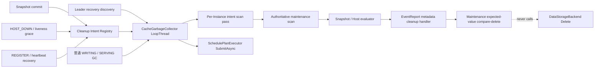

# EventReport 主动回收纳入后台扫描 GC 设计

| 项目 | 内容 |
|---|---|
| 状态 | V1 已实现并完成组件/E2E 验证，待性能与灰度验证 |
| 更新时间 | 2026-08-07 |
| 依赖 | [后台扫描 GC](cache_garbage_collector.md)、[ReportEvent 增量上报与权威快照](report_event_snapshot_uri_version.md) |
| 涉及模块 | `manager`、`data_storage`、`meta`、`metrics`、`service` |

本文定义 EventReport metadata 主动回收接入常驻后台 GC 的行为契约和实现边界。本文只改变清理任务的发现与调度方式，不改变 ReportEvent 的增量、Snapshot、查询可见性和 Reporter 生命周期协议。

## 1. 背景

### 1.1 当前两条清理路径

EventReport metadata 描述 Reporter 外部维护的 cache，不是物理数据本身。当前存在两条结构相似的异步回收路径：

| 触发事件 | 当前入口 | 当前行为 |
|---|---|---|
| Snapshot 成功提交 | `CleanupStaleSnapshotLocations` | 向共享 `SchedulePlanExecutor` 投递任务，按 Instance 全量扫描 metadata，删除目标 Reporter 的旧 generation Location |
| `HOST_DOWN` 或 heartbeat timeout 后超过 cleanup grace | `CleanupHostLocations` | 向同一 Executor 投递任务，按 Instance 全量扫描 metadata，删除目标 host 的全部 EventReport Location |

这些 Location 在清理前已有可见性保护：成功 Snapshot 会通过 committed generation 立即隐藏完全属于旧 generation 的 Location，Reporter unavailable/unregistered 后查询也不会返回其 Location。因此这里的主要问题是 metadata 未及时回收，而不是查询链路继续稳定命中无效数据。

当前调度方式把“一个事件”直接映射为“一次全 Instance 扫描”。连续 Snapshot、多个 Reporter 同时下线或任务重试时，扫描次数随事件数线性增长：同一个 Instance 的相同 keyspace 会被重复执行 `SCAN + GET`，长扫描还会占用 `SchedulePlanExecutor` worker，与 Reclaimer 删除、Migration Prepare/Continuation 等任务竞争共享线程池。

### 1.2 为什么接入后台 GC

后台 GC 已提供以下基础能力：

- 只在 Leader 运行的 `LoopThread` 生命周期；
- authoritative、无 LRU 副作用的 cursor scan；
- 每 tick 一个 batch 的增量推进；
- Instance-aware pending 去重、固定小窗口和共享 Executor 反压；
- 完整 Location 观察值校验；
- round、扫描量、候选、删除结果和错误指标。

EventReport 回收应复用这套线程、Leader 生命周期、maintenance scan 接口和调度预算，把多个事件合并为按 Instance 推进的 cleanup intent scan，而不是继续创建独立全表任务。V1 不把 EventReport pass 与普通 WRITING/SERVING GC pass 合并成同一次 metadata scan；具体边界见 3.2 节。

### 1.3 “旧 generation”的精确定义

Snapshot generation 是 opaque token，不能比较大小。“committed generation 之前”不是数值小于当前 token，而是：对目标 Reporter 的一个稳定 Location，所有 spec 都不属于当前 committed generation，也不属于当前 in-flight generation。

由于增量按 spec name 合并，而清理以完整 Location 为粒度，只要任一 spec 属于当前 committed 或 in-flight generation，就必须保留整个 Location。旧 sibling spec 留给后续完整 Snapshot 收敛，不能为了清理彻底而误删当前有效 spec。

## 2. 设计范围

### 2.1 V1 目标

V1 实现以下能力：

1. Snapshot 成功提交、显式 `HOST_DOWN` 和 heartbeat timeout grace cleanup 只登记或推进 cleanup intent，不再分别投递全 Instance 扫描任务。
2. 同一 Instance 的多个 Reporter/host intent 共用一次 cursor batch；同一 Reporter 的重复 intent 合并，避免 N 个事件触发 N 次完整扫描。
3. intent scan 按 batch、target budget 和 Instance round-robin 推进，并与普通 WRITING/SERVING GC scan 做固定权重让出。
4. stale Snapshot 和 down host 使用各自现有 fencing，最终删除使用扫描时的完整 Location 值做条件 compare-and-delete。
5. EventReport cleanup 只删除 KVCM metadata，不调用 `DataStorageBackend::Delete()`，也不把 Location 交给物理删除状态机。
6. 扫描、提交、重试、积压和合并均可观测；错误不会形成零间隔重试。
7. KVCM 重启后 fail-closed：不根据丢失的进程内 generation 猜测 Snapshot 垃圾；Snapshot intent 由下一次成功 Snapshot 重新建立，down host 通过可重列举、按 Instance 收敛的 recovery discovery 和 grace 重新发现。

### 2.2 V1 非目标

以下能力不进入本次实现：

1. 持久化 cleanup intent、cursor、pending Location 或删除任务。
2. 持久化 committed/in-flight generation、snapshot attempt epoch、Reporter lifecycle generation 或 tombstone。
3. 改变 KVCM 重启后的 EventReport soft 查询语义。
4. Reporter 到 Location 的反向索引、按 Reporter 的 Redis ZSET 或 CDC 候选源。
5. EventReport 后端物理数据删除、URI probe 或 storage version/epoch。
6. 动态 Rule/Handler 插件注册、脚本化规则或跨进程 distributed cleanup lease。
7. 改变 Snapshot/Delta write gate、Snapshot rate limit、heartbeat 或 REGISTER 接口语义。
8. 修改普通 CacheReclaimer、Migration 或后台 GC 的物理删除 Future 生命周期。

V1 只提供一个小型的 typed intent/handler 框架。新增 EventReport 清理类型需要增加 intent payload、匹配函数和删除前授权检查，但不能重新引入“事件触发一次全表扫描”的路径。

### 2.3 依赖和灰度边界

该能力依赖后台 GC 已启用并正常运行。为支持独立合入和灰度，增加 `kvcm.cache_gc.event_report_cleanup_enabled`：

- `false`：保留当前 per-event cleanup 作为兼容回退；
- `true`：要求 `kvcm.cache_gc.enabled=true`，Snapshot/HOST_DOWN/liveness 只登记 intent，不再投递 legacy 全表任务；
- 配置不满足依赖关系时启动校验失败，不能静默进入“既不登记 intent、也不执行 legacy cleanup”的状态。

完成灰度后可以在独立清理 PR 中删除 legacy 路径；本次不把兼容回退与主体改造绑定。

`event_report_cleanup_enabled` 是迁移期临时开关，不是长期产品配置。后台 GC 代码合入本身不等于可以立即删除该开关；需要先完成 EventReport 新链路灰度，确认相关部署均已启用 `cache_gc.enabled`、新旧结果一致且回退窗口结束。随后在同一个清理 PR 中同时删除 legacy per-event scan 和该临时开关。长期只保留 `cache_gc.enabled` 作为后台 GC 总开关。

启动配置只能静态校验 `event_report_cleanup_enabled=true` 时 `cache_gc.enabled` 也必须为 `true`。EventReport Backend 是否存在来自 Leader recovery 后的运行期 InstanceGroup/Storage 状态，也可能通过运行期 Add/EnableStorage 发生变化，不能由 `ServerConfig` 启动解析完整判断。兼容期由 `event_report_cleanup_enabled=false` 的 legacy 路径兜底；删除 legacy 路径后，EventReport Backend 的运行期创建/启用必须校验 GC 可用状态，并通过健康 gauge 暴露不满足依赖的配置，不能静默进入无主动回收路径的状态。

当前 `ServerConfig` 在进程启动时解析，并把 GC 配置值拷贝进 `CacheGarbageCollector::Config`；运行期没有动态配置更新接口。因此 `cache_gc.enabled` 和迁移期 `event_report_cleanup_enabled` 在 V1 都是启动配置，不支持热切换。HA 降级/再次升主只会按对象中保存的原配置执行 Stop/Start，不会重新加载配置。这里的“灰度”指修改配置后的滚动重启灰度；动态开关、在线 Admin API 和运行期参数更新不在本需求范围内。

## 3. 核心设计决策

### 3.1 intent 代表待完成条件，不代表一次任务

cleanup intent 描述“当前仍希望满足的清理条件”，不是一次可重复排队的扫描任务。重复事件更新同一条状态，GC 按当前状态扫描；旧 revision 的候选即使已经选出，也必须在最终删除前重新确认 intent 仍然有效。

### 3.2 按 Instance 合并 EventReport 扫描

metadata cursor 属于 Instance。GC 为每个存在 active intent 的 Instance 维护一个 cursor pass，一个 batch 同时评估该 Instance 下全部 storage type 和 Reporter/host intent。Reporter 数只影响每个 Location 的小规模内存匹配，不再把扫描次数乘以 Reporter 数。

这里的“合并扫描”只发生在 EventReport intent 之间。EventReport intent lane 与普通 WRITING/SERVING GC lane 各自维护 Instance 快照、cursor、pass completion 和 retry 状态，不共享同一次 `SCAN + GET`：

```text
N 个 Snapshot/HOST_DOWN
    -> 同一 Instance 的 1 个 EventReport pass

EventReport pass + regular GC pass
    -> 仍是 2 个独立 pass
```

V1 复用的是同一个 `LoopThread`、HA 生命周期、maintenance scan API 和公平调度框架，不是同一批 metadata 读取。这样设计是因为普通 GC 通常完成一轮后长时间 cooldown，并受物理删除 Future 反压；EventReport 则由事件建立 intent，并在下一个普通 tick 进入调度，需要独立的 intent revision、lifecycle fence 和失败重试。强行共用 cursor 还需要定义规则中途加入、每条规则的独立覆盖进度及不同 cooldown，收益不足以覆盖 V1 的状态复杂度。

因此两条 lane 同时活跃时，同一 Instance metadata 可能在相近时间被扫描两次；V1 明确接受这一成本。当前优化目标是把 EventReport 从“事件数 × Instance keyspace”降为“必要 intent pass 数 × Instance keyspace”，不是把所有后台规则永久收敛为一次全局扫描。只有指标证明跨 lane 重复扫描成为主要负载时，才考虑抽取通用 Scan Coordinator，在一次 batch read 后向多个 evaluator fan-out。

### 3.3 EventReport metadata 删除在 GC 回调中同步完成

V1 不把 EventReport batch 再提交到 `SchedulePlanExecutor`。每个 EventReport Instance pass 先完成必要的 lifecycle preflight，再执行一次 metadata `SyncAll()` barrier；随后 GC `LoopThread` 扫描一个 batch，并直接调用 `MetaSearcher::BatchDeleteLocationsForMaintenance()` 完成有界 expected-value metadata 删除，删除成功后再对本批 key 执行 `Sync()`：

- EventReport 不需要物理 DELETE、delay、`CLS_DELETING` 状态流转或最终 CAD 两阶段；
- 单次 target 数受 `scan_batch_size` 硬限制；maintenance compare-delete 在 MetaIndexer 内按 key 串行处理，每次只持有一个 metadata shard lock，避免一个后台 action 同时锁住默认 `batch_key_size` 对应的大量 shard；
- metadata RMW 会在 `ScopedBatchLock` 内完成 target read、compare 和 backend mutation，因此不仅阻塞 GC 线程，也会阻塞命中相同 MetaIndexer shard 的 StartWrite、FinishWrite、Reclaimer admission/CAS 等 metadata mutation；普通 `MetaIndexer::Get*()` 不获取该 shard lock，但仍可能与 GC 竞争 Local LRU/item lock、Redis QPS、连接池和 AsyncRedis queue；
- cached metadata 模式在 shard lock 内先读取 hot target；只有目标 Location 缺失时才从 persistent 读取该 target 参与比较，不回填完整 key，也不覆盖 hot cache 中的其他 Location；hot target 已存在但值不同表示可能有 barrier 后的新写，必须返回 mismatch；
- HOST_DOWN lifecycle lease 可以从最终校验一直持有到 metadata 删除结束；
- demotion 的 `GC.Join()` 自然等待当前一个有界 metadata batch 返回，不会留下跨 Leader 继续执行的 EventReport cleanup task；
- 不占用共享 Executor worker，也不需要为这条 metadata-only 路径复制 promise/Future 状态机。

默认 `mutex_shard_num=1024` 时，maintenance action 任一时刻最多持有一个 shard（约 0.1%）；多个 key 顺序推进，不再一次占用最多约 12.5% shard。persistent-only 模式或 cached 模式的 target miss 仍会把 persistent read/write 延迟带入当前单 shard 临界区；hot hit + AsyncRedis 模式通常只包含 Local read/delete 和异步 enqueue，但 enqueue 反压仍会延长持锁时间。`MetaIndexer::Sync(delete_keys)` 在全部 RMW 返回、shard lock 释放后执行，只有 Reporter lifecycle lease 持有到 Sync 完成。

普通 WRITING/SERVING GC 候选仍沿用 `SchedulePlanExecutor::SubmitAsync()`；本设计只对 EventReport metadata reconciliation 使用直接条件删除。

当前 `CacheLocationDelRequest::metadata_only` 仍会经过 `CLS_DELETING` admission 和异步 Future，并且请求本身不能把 EventReport intent revision 与 lifecycle lease 贯穿到最终 CAD。直接复用它需要扩展通用 Executor 的业务前置条件和 lease 生命周期。V1 沿用现有 Host cleanup 的“expected-value metadata compare-delete”业务语义，但不是直接复用现有 `BatchDeleteLocations()` 实现：7.4 节定义的 maintenance target read/delete、分层结果和 no-touch/no-backfill 契约需要贯穿 meta 各层。单批扫描、action-time fence、条件删除和 Sync 仍收敛在同一个有界 GC tick 内；legacy 回退继续走原 `metadata_only` 路径。后续若形成通用的 metadata reconciliation task，再把该有界 action 下沉到 Executor，不改变 intent 和扫描模型。

该取舍与 Reclaimer 的异步 metadata admission 不矛盾。Reclaimer 处于容量水位压力路径，需要快速遍历 Group、及时生效 in-flight credit，不能让一次 Get/CAS/Sync 阻塞后续回收决策；EventReport GC 是低优先级、最终一致的后台收敛路径，没有水位止损 SLA，也不要求一个 tick 内持续提交任务。V1 因此接受一个有界 metadata batch 暂停 GC 自身调度，以换取更少的 Future/pending 状态以及更直接的 lifecycle/demotion 边界。

“有界”仅限制 key/Location 数量，并不保证 Redis 延迟或在线 mutation 的等待时间；慢 metadata 操作会暂停 EventReport lane、regular lane，使当前相同 shard 的 metadata mutation 排队，并令 `GC.Join()` 等待到底层 command timeout。该风险必须通过 action duration、shard lock wait、shard lock hold、在线 Start/Finish/Reclaimer 延迟、Join latency 和 metadata error 指标验证。把 action 移入 Executor 只能解除 GC tick/Join 的同步等待，不能消除 MetaIndexer shard lock 和 Redis 资源竞争；只有实测证明 GC 线程阻塞成为主要问题时，再引入带 action-time fence 和 GC lifecycle token 的异步 metadata cleanup task。

### 3.4 不持久化进程内 generation

当前 EventReport committed generation、in-flight generation、attempt epoch、node generation 和 tombstone 都是进程内状态。只持久化 cleanup intent 而不同时持久化并原子更新这些授权状态，会使旧 intent 在重启后缺少可靠 fence，反而可能删除新生命周期数据。

因此 V1 选择安全的重新发现：进程重启或 Leader 切换时丢弃 intent/cursor；Snapshot cleanup 等下一次成功 Snapshot 重新建立，host cleanup 通过 metadata 中的 Reporter identity 和恢复 grace 重新发现。若后续要求“不依赖新 Snapshot 也恢复旧 generation cleanup”，必须单独设计 committed generation、attempt 和 lifecycle 的持久化事务，不能只给 GC map 加落盘。

## 4. 总体架构



| 组件 | 新增或调整职责 |
|---|---|
| `CacheManager::ReportEvent` | Snapshot commit 和显式 HOST_DOWN 后登记 intent；REGISTER/恢复事件取消已失效的 host intent |
| `EventReportBackend` | liveness cleanup 保留“先 callback、再 generation-checked unregister”的 heartbeat fencing；callback 只登记 intent，最终 action 通过 tri-state lifecycle lease 复核；继续提供 committed/in-flight、attempt epoch，并补充“Reporter 当前不存在”清理 lease |
| `CacheGarbageCollector` | 保存可合并 intent、按 Instance 调度 cursor pass、执行匹配和有界 metadata 删除 |
| `MetaIndexer` | 继续提供 authoritative、no-touch 的 `ScanLocationsForMaintenance()`；增加 Instance 级 `SyncAll()` barrier 和独立的 maintenance target compare-delete 契约；action 按单 key/shard 串行，并暴露 shard-lock wait/hold |
| `MetaStorageBackendManager` 与各 metadata backend | 实现 target-level missing-only persistent read、no-backfill/no-touch 删除和 hot/persistent 分层结果；不能复用现有整 key refresh/fallback 语义 |
| `MetaSearcher` | 对外提供 maintenance expected-value compare-delete，并返回足以区分 hot/persistent 实际删除和 whole-key reclaim 的逐 target 结果 |
| `SchedulePlanExecutor` | 不承载 EventReport 扫描或 metadata-only handler；普通 GC/Reclaimer/Migration 行为不变 |

本次仍属于 `manager` 对 `meta` 和 `data_storage` 的编排，不引入反向依赖，也不把 EventReport 业务状态下沉到通用 Executor。

## 5. Cleanup Intent 模型

### 5.1 身份和 payload

```cpp
enum class EventReportCleanupIntentType {
    kStaleSnapshot,
    kDownHost,
    kRecoveryAbsentHost,
};

struct EventReportCleanupIntentKey {
    std::string instance_id;
    DataStorageType storage_type;
    std::string host_ip_port;
};

struct SnapshotCleanupPayload {
    std::string committed_version;
    uint64_t snapshot_attempt_epoch;
    uint64_t lifecycle_generation;
};

struct HostCleanupPayload {
    uint64_t lifecycle_generation;
};

struct EventReportCleanupIntent {
    EventReportCleanupIntentKey key;
    EventReportCleanupIntentType type;
    uint64_t revision;
    std::chrono::steady_clock::time_point created_at;
    std::weak_ptr<EventReportBackend> backend_incarnation;
    std::variant<SnapshotCleanupPayload, HostCleanupPayload> payload;
};
```

`instance_id + storage_type + host_ip_port` 是完整 Reporter 身份。`backend_incarnation` 使用当前进程内 backend 对象身份做额外 fail-closed 校验：对象销毁、被替换或从当前 storage registry 移除时，旧 intent 不能落到新创建的 backend。`SetAvailable(false)` 不改变对象身份，因此 scan 和 action-time 还必须显式检查 `Available()`；同一对象暂时 unavailable 时保留 intent 并退避，不能误当成 incarnation 变化后取消。

`revision` 只在当前 Leader 进程内单调递增，用于判断一个 scan pass 覆盖的是不是 intent 的最新状态；它不是分布式 epoch，也不会落盘。Snapshot intent 同时记录 `BeginSnapshot()` 捕获的 lifecycle generation，防止已经选出的 Snapshot cleanup 越过 HOST_DOWN/REGISTER 边界。

### 5.2 合并与覆盖规则

| 当前状态 | 新事件 | 结果 |
|---|---|---|
| 无 intent | Snapshot commit | 新建 `kStaleSnapshot` |
| 相同 Reporter 的 Snapshot intent | 相同 version/attempt 重试 | 保留原 revision，计入 merge |
| 相同 Reporter 的 Snapshot intent | 新 version/attempt commit | 用新 payload 覆盖并递增 revision |
| Snapshot intent | HOST_DOWN/liveness cleanup | `kDownHost` 覆盖 Snapshot intent；host 全量清理语义更强 |
| DownHost intent | 旧 lifecycle 的 Snapshot callback | 保留 DownHost；旧 Snapshot 不能把 host 全量清理降级为 generation 清理 |
| 相同 lifecycle 的 DownHost 重试 | 相同 generation | 合并，不重启 pass |
| DownHost intent | REGISTER 或 heartbeat 恢复到新 generation | 取消旧 intent |
| 任意较新 lifecycle intent | 较旧 generation 的迟到 Host callback | 忽略旧 callback，保留较新 intent，计入 `stale_ignored` |
| 任意 intent | backend incarnation 改变、storage 移除或 Instance 删除 | fail-closed 取消 |
| 任意 intent | 同一 backend 暂时 `Available()==false` | 保留 intent，按 backend-unavailable 退避重试 |

合并操作只更新小型内存 map；事件线程不执行 `SCAN`、`GET` 或 metadata 删除，也不对每个事件调用 `LoopThread::RunOnce()`。GC 本身每 `scan_interval_ms` 调度一次，EventReport 最多等待一个普通 tick 即可开始推进；这一取舍用最多一个 interval 的延迟换取事件风暴下的天然合并和严格 tick 下界。

显式 HOST_DOWN 先通过 `UnregisterNodeForHostDown()` 完成 lifecycle writer，再登记捕获到的 generation。liveness checker 保留既有的“先 callback、再 `UnregisterNodeIfGeneration()`”顺序，使 callback 执行期间到达的 heartbeat 仍可推进 generation 并让 conditional unregister 失败。这里 callback 只登记 cleanup intent，不代表已经取得删除授权：若 GC 恰好在 unregister 完成前消费该 intent，same-generation active lease 返回 `kBusy` 并重试；若 heartbeat 已推进 generation，则返回 `kStale` 并取消旧 intent。

事件完成与 intent map 更新不是同一把锁，因此每种入口都要保留与其事件顺序匹配的 fence：

- Snapshot commit callback 先获取 captured generation 的 active mutation lease，并复核 committed version 与 attempt epoch，再写入 Snapshot intent；
- 显式 HOST_DOWN 在 generation-checked unregister 成功后登记；liveness callback 可在 unregister 前登记，但 Host intent 只在 action-time down lease 成功后获得删除授权；
- recovery observation 到期转 intent 时，先获取 absent Reporter lease，再写入 RecoveryAbsentHost intent。

Snapshot/Recovery lease 持有到 intent map 更新完成。Host intent map 额外按 lifecycle generation 单调合并：较旧 callback 即使晚到也不能覆盖较新 intent。事件路径只在观察到严格更大的 active generation 时取消 Host intent；same-generation 事件可能处在 liveness callback 与 conditional unregister 之间，不能提前擦除已发布 intent。REGISTER 或 heartbeat recovery 已推进 generation 时，旧 Host intent 最终会被事件路径或 action-time lease 取消。intent mutex 内不获取 lifecycle lease，I/O 阶段也不持有 intent mutex。

### 5.3 并发访问

ReportEvent、liveness checker 和 GC `LoopThread` 会并发访问 intent。V1 使用一把短临界区 mutex 保护 intent map 和 revision 分配：

- 事件线程只做查找、合并和取消；
- GC 每个 batch 开始时复制当前 Instance 的 intent snapshot，随后释放锁再做 metadata I/O；
- 删除前再次按 key/revision 校验；
- 不在持有 intent mutex 时调用 Registry、MetaIndexer、EventReportBackend 或 metrics。

现有在线 mutation 使用的 `AcquireLifecycleMutationLease()` 以 `try_to_lock` 避免 metadata-lock/lifecycle-lock 反序死锁，并把“锁正被 writer 占用”和“generation/registration 已失效”都映射为 `EC_NODE_NOT_REGISTERED`。GC action 不能复用这一模糊结果做状态决策。V1 增加 GC-facing lease result：

```cpp
enum class CleanupLeaseAcquireResult {
    kAcquired,
    kBusy,
    kStale,
};
```

`kBusy` 表示瞬时锁争用，保留 intent 并按正常 interval/退避重试；`kStale` 表示 generation、registered/absent 条件已经失效，取消旧 intent；只有 `kAcquired` 才进入 metadata action。该扩展不改变现有在线 mutation API 的错误码语义。

## 6. 增量扫描与公平调度

### 6.1 两条扫描 lane

GC `LoopThread` 内保留两条逻辑 lane：

1. **Intent lane**：扫描存在 active EventReport intent 的 Instance，并在每次 Leader recovery 后运行可重列举、按 Instance 收敛的 EventReport identity discovery cycles；该 lane 绕过普通 full-round 的 24 小时 cooldown；
2. **Regular lane**：现有长期 WRITING 和普通 SERVING storage-missing full round。

两条 lane 共享一个线程但不共享 cursor/pass。调度器每个 tick 只推进其中一条 lane 的一个 batch；选择 EventReport lane 不会顺带推进 regular cursor，反之亦然。

V1 使用固定的 `4:1` 最大小权重：连续最多推进 4 个 intent batch；如果 regular lane 当前可运行，则至少让出 1 个 tick 给 regular lane。没有 regular 工作时不人为 sleep，继续按普通 `scan_interval_ms` 推进 intent。

该权重先作为代码常量，避免增加难以调参的配置。真实负载证明需要调整后，再将其配置化。

Intent/recovery lane 的 metadata action 不使用 Executor，因此它的扫描准入位于普通 GC Future 窗口检查之前。普通物理删除 Future 全部占满时，EventReport intent 和当前 Leader epoch 的 recovery discovery 仍可以按自己的每 tick budget 推进；它们不能借此在一个 tick 内执行多个 batch。

### 6.2 Per-Instance pass

```cpp
struct EventReportIntentScanState {
    std::string cursor = SCAN_BASE_CURSOR;
    uint64_t pass_id = 0;
    std::map<EventReportCleanupIntentKey, uint64_t> pass_revisions;
    bool sync_barrier_complete = false;
    bool revisit_required = false;
    uint32_t consecutive_failures = 0;
    std::chrono::steady_clock::time_point next_retry_at;
};
```

调度规则：

1. active Instance 按 `instance_id` 排序并 round-robin，每个 tick 最多推进一个 Instance 的一个 cursor batch；
2. pass 从 base cursor 开始时冻结当前 intent revision 集合；cached metadata 的异步 recover 未结束时不开始 pass，ready 后再调用 `MetaIndexer::SyncAll()`，barrier 失败时不开始 Scan；
3. `SyncAll()` 保证 intent 登记前已经 accepted 的 AsyncRedis mutation 在全部 consumer queue 中先于本 pass 落稳；barrier 后的新写由 hot-cache expected-value 比较保护；
4. 同一 batch 对冻结集合中的全部 Reporter/host 做匹配；
5. cursor 回到 base 且本 pass 的 metadata 删除均已同步返回后，才判定 pass 完成；
6. 只移除 revision 与 pass 起点仍一致、且 fence 仍有效的 intent；pass 中途新增或更新的 intent 留给下一 pass；
7. target budget 截断、expected-value mismatch 或 pass 中途 revision 更新只设置 `revisit_required`，它们是正常并发/覆盖不足，不增加失败 backoff；cursor 到 base 后从新 pass 重新覆盖；
8. barrier/scan/delete 等真实失败增加 `consecutive_failures`，保留 intent 并从 base 重试；backoff 从 `scan_interval_ms` 起步、上限 60 秒；任一 batch 在对应失败阶段取得成功进展后立即清零 `consecutive_failures` 和旧 backoff；
9. Registry recovery 尚未完成时，Indexer/backend 暂时不存在按可重试处理；只有 authoritative Registry 已确认 Instance/storage 删除，或 backend incarnation 已被替换时，才取消对应 runtime intent；
10. pass 中途所有 live intent 都被取消时，已经冻结的 pass 仍继续从当前 cursor 走到 base 并清空 context；后续新 intent 必须从新的 barrier 和 base cursor 开始，不能继承旧 pass 的半程状态。

由于一个 pass 开始后到达的新 intent 没有覆盖已经扫过的 key，所以不能在当前 cursor 到 base 时顺带标记完成。这个 revision 规则保证合并不会以遗漏为代价。

### 6.3 Batch 和 target budget

- 复用 `scan_batch_size` 作为 metadata key 数 hint；backend 实际返回量可能超过 hint，调用方不能假设硬上限；
- 每个 tick 最多删除 `scan_batch_size` 个 Location；超出部分只设置 `revisit_required`，在下一 pass 重新覆盖，不计 operation error；
- 一个 Location 同时命中多个 intent 时只生成一个 target，优先级为 `DownHost > RecoveryAbsentHost > StaleSnapshot`；
- EventReport direct metadata delete 不占普通 GC 的 Future 槽位，但仍受“每 tick 一个 scan batch + 一个 target batch”约束；
- 普通 GC 的 `pending_locations_` 继续覆盖 Executor accepted 到 CAS 窗口；EventReport 不建立物理删除 pending，但每个 active Instance 至多保留一个、大小不超过 target budget 的 maintenance retry/accounting batch，防止重试重复扣减 usage/key count。该 retry 携带已经发生但尚未结算的 mutation flag，不能按次数上限直接丢弃；V1 采用最高 60 秒退避并保留到成功或进程生命周期结束。它只暂停对应 Instance，其他 Instance 继续推进，并由 retry count、retry batch count 与 oldest intent age 暴露长期积压。

### 6.4 为什么不为每个 intent 保存 cursor

cursor 对应 Instance keyspace，而不是 Reporter。为每个 Reporter 保存 cursor 会重新退化为 N 次扫描。V1 每个 active Instance 只有一个 cursor，pass 内的 intent snapshot 是该 cursor 的全部过滤条件。

## 7. 候选判定和条件删除

### 7.1 Snapshot stale handler

GC 不重新定义 Snapshot stale 业务语义。实现时必须抽取并复用当前 `CacheManager::CleanupStaleSnapshotLocations()` 使用的 `IsSnapshotLocationStale(..., preserve_in_flight=true)` 判定及其回归测试；本需求只把候选扫描与调度迁移到 GC，并在原判定外增加 intent/action-time fence。

Location 先满足以下归属和 intent 有效性条件：

1. `instance_id` 与 intent 完全一致；
2. `location.type()` 与 intent storage type 一致；
3. Location ID 能解析出 intent 的 `host_ip_port`；
4. backend 对该 Reporter 的当前 committed version 与 intent payload 相同；
5. 当前 snapshot attempt epoch 与 intent payload 相同；
6. Reporter lifecycle generation 与 intent payload 相同；

随后严格沿用现有 stale 判定：

- Location 没有 spec：stale；
- 任一 spec 的 `s_version` 重复或格式非法：stale；
- 其余情况下，完全由 legacy/旧 version spec 组成：stale；
- 其余情况下，只要任一 spec 属于当前 committed generation，或属于当前 in-flight generation：保留整个 Location。

malformed spec 是现有实现中的硬 invalid 分支，会直接判 stale；“任一当前 spec 保护整个 Location”只适用于其余格式可判定的 mixed-generation/legacy 场景。V1 不借职责迁移改变该行为。

新的 Snapshot attempt 会推进 attempt epoch，使旧 intent 立即失效。旧 pass 已观察到的 target 在删除前还会检查 revision、backend incarnation、backend availability、committed version、attempt epoch 和 lifecycle generation，并通过 5.3 节定义的 GC-facing active lifecycle lease 持有当前 lifecycle 到本批删除完成；`kBusy` 保留 intent 重试，`kStale` 取消旧 intent。如果新 Snapshot/Delta 已修改该稳定 Location，完整 expected value 也会使 compare-and-delete 返回 mismatch。

### 7.2 Down host handler

DownHost intent 匹配同一 Instance、storage type、host 的全部 EventReport Location，不检查 `s_version`。删除前必须：

1. 确认 intent key/revision 仍为当前值；
2. 确认 backend incarnation 未变化且 backend 仍 `Available()`；
3. 调用返回 `kAcquired/kBusy/kStale` 的 GC-facing cleanup lease；
4. 持有 lease 完成该 batch 的 expected-value metadata 删除。

如果 Reporter 已重新 REGISTER 或 heartbeat recovery 已推进 lifecycle generation，lease 返回 `kStale`，整个 intent 作为过期状态取消；瞬时 writer 争用返回 `kBusy`，保留 intent 并让出本 tick。liveness callback 与 conditional unregister 之间，Reporter 仍是相同 generation 的 active 状态，该状态也返回 `kBusy`，不能误判为 stale 后丢失 intent。若 cleanup 已先取得 lease，REGISTER 会等待当前有界 metadata batch 完成；它不会与旧 lifecycle 删除交叉执行。

显式 HOST_DOWN intent 在 `UnregisterNodeForHostDown()` 完成后登记；liveness intent 可以先登记，但 pass 在 `SyncAll()` 前必须先尝试一次 down-lifecycle lease：same-generation 仍活跃或 writer 正在 unregister 时返回 `kBusy`，本 tick 不执行 barrier/scan；generation 已变化时返回 `kStale` 并取消旧 intent；只有确认 down 状态后才释放这把短 lease 并执行 barrier。两个 unregister 都持有 lifecycle writer lock 并等待旧 lifecycle 的 mutation shared lease 退出，因此成功 preflight 后的 `SyncAll()` 一定排在此前准入的 mutation enqueue 之后。删除前仍需重新获取 down lease，防止 preflight 后 REGISTER 的新 lifecycle 被旧 pass 删除。

### 7.3 重启后的 absent host handler

Leader recovery 后 EventReport node table 为空，不能把“当前未注册”立即等同于 HOST_DOWN。GC Start 后启动 recovery discovery cycle；它复用 Registry 列举和普通 maintenance cursor，但维护独立的 per-Instance `cursor/discovery_done/next_retry_at`，可以与该 Instance 的 active intent 在同一 batch 中评估，且不依赖普通 GC Future 窗口。

recovery discovery 不能只依赖 GC Start 时的一次 Registry 快照。`RegistryManager::DoRecover()` 和 `CacheManager::DoRecover()` 在部分失败时会返回 `EC_OK` 并由后台线程继续恢复，首次快照可能缺少尚未建立 Indexer 的 Instance。V1 按以下规则收敛：

1. 每个 discovery cycle 重新列举 Group/Instance，把新出现的 Instance 合并到 recovery state；
2. 只有某 Instance 的 cursor 回到 base，才设置该 Instance 的 `discovery_done=true`；Indexer 暂缺、List/Scan 失败或 backend unavailable 均不标记完成，按 capped backoff 重试；
3. 已完成的 Instance 不在同一 Leader recovery 中重复扫描；
4. `RegistryManager::IsRecoverComplete()` 为 false 时继续周期性重列举；首次观察到 true 后，再取得一份完整 Registry 快照；
5. 只有这份 recovery-complete 快照中的全部 Instance 都 `discovery_done`，才结束本 Leader epoch 的 discovery。之后不再高频全扫。

这样既不会因部分恢复永久漏掉 Instance，也不会把 discovery 绑定到 regular lane 的 24 小时 cooldown。GC 发现可解析的 EventReport Reporter identity、但 backend 中没有运行时 node 时，先记录 recovery observation：

```text
first_seen_absent + heartbeat_timeout + cleanup_grace
```

deadline 前收到 REGISTER、HEARTBEAT、ADD/DELETE/SNAPSHOT 并重建 node，则删除 observation，不建立 cleanup intent。deadline 后仍不存在 node，转为 `kRecoveryAbsentHost` intent。

该 handler 使用 GC-facing absent Reporter lease：在同一 per-reporter lifecycle fence 下确认 node 仍不存在；`kBusy` 保留 observation/intent 重试，`kStale` 表示 Reporter 已恢复并取消清理，`kAcquired` 时持有 lease 完成条件删除。后到的 REGISTER 要么先建立新 lifecycle 使 cleanup 失效，要么等待当前有界 batch 完成，不能与删除交叉。

discovery batch 本身只记录 identity，不删除 metadata；recovery-complete 快照全部收敛后结束 discovery。这个机制让 KVCM 在稳定 Leader 下重新发现“旧进程已经决定下线、但 intent 随重启丢失”的 host metadata，同时给正常 Reporter 足够时间恢复 heartbeat。反复重启会重新开始 grace，V1 选择避免误删而不是跨进程累计 deadline。

### 7.4 最终 metadata action

扫描为每个 target 保存：

```text
(instance_id, block_key, location_id, expected_location_value, intent_key, intent_revision)
```

删除阶段先按最新 intent/fence 过滤，再把剩余 target 按 block key 组织为 maintenance compare-delete 请求。Snapshot intent 获取 active lifecycle mutation lease，DownHost/RecoveryAbsentHost 获取对应 cleanup lease。多个 Reporter lease 按 `(storage_type, host_ip_port)` 排序获取，并持有到本批 RMW 与 Sync 完成；GC 单线程保证不会出现两个 cleanup batch 反向获取 Reporter lease。

该 action 不能只给现有 `BatchDeleteLocations()` 增加一个 boolean 后复用普通读写路径。现有 cached backend fallback 会整 key 回填，Local `Lookup()` 会设置 hit、改变 LRU 并调用 `TouchAccessTime()`，现有返回值也会让 cache `EC_NOENT` 遮蔽 persistent 已实际删除的结果。V1 必须提供显式的 maintenance target read/compare-delete 接口，并贯穿 MetaSearcher、MetaIndexer、MetaStorageBackendManager 和各 backend。

每个 key 独立获取一个 MetaIndexer shard lock，并在锁内完成 compare 和 backend mutation；一个 key 完成后立即释放，再处理下一个 key，全部锁均在 `Sync()` 前释放。该临界区仍会与相同 shard 的 StartWrite、FinishWrite、Reclaimer/Executor RMW 直接竞争，但不会让一个默认 128-key action 同时占用约 12.5% shard，不能描述为 GC 私有开销。

maintenance compare-delete 在 metadata shard lock 内执行以下逻辑：

1. hot cache 中存在目标 Location：直接与扫描值比较；相同才允许删除；
2. hot cache 中缺少目标 Location：只从 persistent backend 读取对应 target 参与比较，不把完整 key 或 target 回填 hot cache；persistent 值与扫描值相同才允许重试删除；
3. hot target 存在但值不同：视为 barrier 后的新写或仍在收敛的 cache/persistent 差异，返回 `EC_MISMATCH`，绝不能用旧 persistent 值覆盖；
4. hot 与 persistent 都没有目标：返回 `EC_NOENT`；
5. 没有 cache backend：直接在 persistent RMW 中比较。

Local backend 的 maintenance 读和删不能调用普通 touching `cache_->Lookup()`。V1 增加精确 key 的 `ApplyToEntryNoTouch()`：它不设置 hit、不移动 LRU、不更新时间，并在同一 LRU shard 临界区内完成一个有界 item copy/delete。全 shard 的 `ScanLocationsForMaintenance()` 在 shard iteration 锁内只复制 key，退出 iteration 后再逐 key 调用 no-touch 接口，避免在全 shard 遍历期间获取 item mutex。锁序固定为精确 LRU shard → item；普通 update/delete 在释放 item mutex 后才调用 `AdjustCharge` 获取 shard mutex，不存在 item → shard 的嵌套反向路径。

该规则与普通 GC 的 unconditional authoritative refresh 不同。EventReport Snapshot/Delta 在 cached + async persistent 模式下会先 enqueue Redis mutation、再更新 local cache；barrier 后到达的新 generation 可能暂时只存在于 hot cache。无条件 persistent refresh 会用旧 generation 覆盖新值，因此本路径必须使用 target-level missing-only compare read。它也允许一次异步删除 Sync 失败后，从仍有旧值的 persistent target 重新发起幂等删除，而不会为了重试覆盖整个 hot key。

maintenance read/delete 不调用在线 `TouchAccessTime()`，不更新 LRU、hit/revisit 统计，也不把 persistent compare value 回填 hot cache。现有单一 `ErrorCode` 不足以表达分层结果，maintenance API 至少逐 target 返回：

```cpp
struct MaintenanceLocationDeleteResult {
    ErrorCode ec;
    bool removed_from_hot = false;
    bool removed_from_persistent = false;
    bool reclaimed_hot_key = false;
    bool reclaimed_persistent_key = false;
};
```

调用方必须能够区分“首次逻辑删除”“hot 已删、仅重试 persistent”“两层均不存在”和“值已变化”。当 hot target 缺失而 persistent 首次删除成功时，不能被 cache `EC_NOENT` 覆盖。是否删除整个 metadata key 必须基于 hot 与 persistent 两层 Location ID 的并集决定：只有两层都不含未授权 Location 时才可 whole-key reclaim；任一层仍有新 Location 时，两层都只删除目标 Location，避免异步收敛窗口误删另一层的新值。storage usage 与 reclaimed key count 只在首次逻辑删除持久化确认后提交一次，所有减法沿用 saturating 语义。

最终 compare-delete 结果为：

- 值相同：返回本次 hot/persistent 实际 mutation 结果，等待 Sync 后提交 accounting；
- Location 不存在：幂等成功；
- 值已变化：`EC_MISMATCH`，正常竞态，不记 operation error，但本 pass 标记 `revisit_required`；
- backend/shape/metadata 错误：本 pass 失败，保留 intent 重试。

RMW 返回后调用 `MetaIndexer::Sync(delete_keys)`。只有 Sync 成功且本批没有 hard error，才根据当前结果与 prior result 合并后的分层 mutation flag 提交一次 storage usage/reclaimed key count；mutation flag 表达已经发生的历史事实，即使本次复核因新值返回 `EC_MISMATCH` 也不能丢弃。Sync 或部分删除失败时，为该 Instance 保留这个有界 batch 的 expected value 和累计分层结果，下一 tick 在重新取得 intent/lifecycle fence 后优先重试，不能退化为无状态重扫后再次扣减。成功提交 accounting 后立即移除 retry batch。进程退出会丢弃该内存重试状态；新进程从 persistent metadata 恢复 usage/key count，因此不跨进程恢复。

pass 起点的 `SyncAll()` 解决历史 accepted mutation 的可见性，batch 结尾的 `Sync(delete_keys)` 解决本次删除的持久化，两者缺一不可。cached metadata 的异步 recover 完成前不启动 EventReport pass，meta 层也会拒绝 maintenance compare-delete，避免 recover 持有的旧 persistent snapshot 在删除后重新回填 hot cache。若重试发现 persistent 已无 target，表示此前删除已落盘，可以完成尚未提交的 accounting；若 persistent 值已变化则返回 mismatch，保留新值，同时在 Sync 后结清此前已经发生的 mutation accounting。若 hot/persistent 仍不一致，则 intent 保持积压并通过指标暴露，不能以清理完整性为由覆盖较新的 hot value。

EventReport 路径不执行 `SERVING -> DELETING` CAS，不调用 `Sync + DataStorage Delete + CAD`，也不设置 `metadata_only` 后进入通用物理删除任务。它直接执行带 expected value 的 metadata compare-and-delete，因此不会产生 EventReport `CLS_DELETING` 中间态。

### 7.5 与并发路径的仲裁

| 并发场景 | 最终保护 |
|---|---|
| Snapshot cleanup 与新 Snapshot | lifecycle lease、committed/attempt 复核；新写入导致 expected value mismatch |
| Snapshot cleanup 与新 Delta | 同 lifecycle 可并发，Delta 刷新的稳定 Location 值变化使旧删除 mismatch；mixed-generation Location 中当前 spec 保护整条 Location |
| Snapshot cleanup 与 HOST_DOWN/REGISTER | Snapshot cleanup 持有捕获 generation 的 lifecycle lease，不能越过 lifecycle writer |
| Host cleanup 与重新 REGISTER/heartbeat recovery | lifecycle generation lease 覆盖最终 metadata 删除 |
| EventReport cleanup 与 Reclaimer/其他删除者 | metadata RMW 的 expected value/NOENT 使至多一方删除成功 |
| backend 对象替换/remove | process-local backend incarnation 不匹配，intent fail-closed 取消 |
| 同一 backend 暂时 unavailable | action-time `Available()` 检查失败，保留 intent 并退避；不执行 metadata 删除 |

## 8. 生命周期、失败与重启

### 8.1 Leader 启停

升主沿用后台 GC 的启动顺序。EventReport intent 只在 GC Start 成功后接收；leader-only 请求开放前 GC 已可消费 intent。

`RequestStop()` 除设置 scan stop flag 外，还要原子关闭 intent admission。EventReport liveness callback 只捕获 `weak_ptr<CacheGarbageCollector>` 和 backend incarnation，不读取 `CacheManager` 的 GC 成员；进程析构按 `RequestStop -> ClearEventCleanupCallbacks -> Join/reset` 执行。这样即使 liveness 线程已经把 callback 拷贝到锁外，回调也只会观察到关闭的 admission 或失效 weak reference，不会与 shared_ptr reset 数据竞争或解引用已析构对象。`Join()` 在 `LoopThread` 停止后清空 intent、cursor、backoff 和 recovery observation；相同进程再次升主时按重启语义从 base cursor 和 recovery discovery 重新开始。

降级顺序保持：

```text
GC.RequestStop() + Reclaimer.Pause()
  -> DisableLeaderOnlyRequests()
  -> WaitForAllLeaderOnlyRequestsToComplete()
  -> GC.Join()
  -> MigrationManager.Stop()
  -> CacheManager/RegistryManager DoCleanup()
```

EventReport 删除在 GC `LoopThread` 内同步执行，因此 `Join()` 最多等待当前一个有界 scan/delete batch 按底层 metadata timeout 返回。Join 完成后不存在仍排队或 detached 的 EventReport cleanup action；普通 GC 已接受的物理删除 Future 仍沿用原有 best-effort detach 语义，不在本需求修改。

### 8.2 进程重启语义

| 状态 | 重启后行为 |
|---|---|
| intent map、cursor、backoff、recovery observation | 全部丢弃，从 base cursor 重新开始 |
| 已同步完成的 metadata 删除 | 自然保留，重复扫描幂等 |
| 正在执行的 EventReport metadata batch | 进程退出时中断；新 Leader 后续重新扫描 |
| Snapshot stale intent | 不从 URI 猜 committed generation；下一次成功 Snapshot 重新登记 |
| HOST_DOWN/liveness intent | Leader Start 的 recovery discovery cycles 按 Instance 读取 metadata Reporter identity，再经 absence grace 重新发现 |
| Reporter 在 grace 内恢复 | node 重建并取消 absence observation，不删除 |

“下一次成功 Snapshot”是 Snapshot cleanup 跨重启重新发现的必要条件。当前协议故意不持久化 committed generation，并在重启后进入 soft mode；没有新的 authoritative Snapshot 时，GC 无法安全区分历史 generation 的新旧。V1 不以清理完整性为由破坏这项可用性契约。

### 8.3 错误处理

| 场景 | 行为 |
|---|---|
| intent 登记重复 | 合并并计数，不唤起新的独立 scan task |
| intent map 更新异常 | ReportEvent 主操作结果不回滚；记录错误，等待重试事件或恢复扫描 |
| Registry recovery 未完成且 Indexer/backend 暂缺 | 保留 intent/discovery state，按 backoff 重列举和重试 |
| cached metadata 异步 recover 尚未完成 | 不执行 `SyncAll/Scan/Delete`，按 `meta_recovering` 退避；meta 层拒绝直接 maintenance mutation，防止旧 snapshot 回填复活 |
| authoritative Registry 确认 Instance/storage 已删除或 backend 对象已替换 | 取消对应 runtime intent，记录取消原因 |
| 同一 backend 暂时 unavailable | 不扫描或删除，保留 intent 并按 `backend_unavailable` 退避 |
| `SyncAll()` barrier 失败 | 不开始本 pass Scan，按 capped backoff 重试，并让出其他 Instance |
| maintenance scan 失败 | cursor 不推进，按 capped backoff 重试，并让出其他 Instance |
| batch shape 不一致 | 整批不删，保留 intent 重试 |
| committed/attempt/revision/incarnation 变化 | 正常取消旧 Snapshot intent，不记数据错误 |
| lifecycle lease `kBusy` | 瞬时争用；保留 intent，至少等待正常 interval 后重试 |
| lifecycle lease `kStale` | generation/registered/absent 条件失效；正常取消旧 intent，不记数据错误 |
| target budget 截断或 expected value mismatch | 正常覆盖不足/竞态，不记 operation error；设置 `revisit_required`，下一 pass 重新判断 |
| `EC_NOENT` | 幂等成功，不记 operation error |
| maintenance compare-delete 部分失败 | 成功 target 保持结果；intent 不完成，失败项下一 pass 重新覆盖 |
| Sync 失败 | 为该 Instance 保留一个有界 retry/accounting batch，重新取 fence 后重试，不重复扣减 usage/key count；其 backoff 不阻塞其他 Instance |
| stop 请求 | 不开始新 batch；当前同步 metadata 调用返回后退出 |

所有 retry/revisit 都至少经过 `scan_interval_ms`，不调用 `RunOnce()` 绕过该下界。单 Instance 的 backoff 不阻塞其他 active Instance；对应失败阶段一旦成功推进，立即清零该 Instance 的 `consecutive_failures` 和旧 backoff，避免恢复后仍按最大间隔运行。

## 9. 可观测性

在现有 `cache_gc.*` 指标族下增加：

| 指标 | 类型 | 说明 |
|---|---|---|
| `cache_gc.event_report_intent_count{reason}` | Gauge | 当前 active intent 数；reason 为 `stale_snapshot/down_host/recovery_absent_host` |
| `cache_gc.event_report_intent_update_count{reason,result}` | Counter | 新建、合并、覆盖、取消和迟到旧 lifecycle intent 忽略次数 |
| `cache_gc.event_report_active_instance_count` | Gauge | 当前至少包含一个 active intent 的 Instance 数 |
| `cache_gc.event_report_oldest_intent_age_ms` | Gauge | 最老 active intent 年龄 |
| `cache_gc.event_report_recovery_pending_instance_count` | Gauge | 当前 recovery discovery 尚未完成的 Instance 数 |
| `cache_gc.event_report_recovery_observation_count` | Gauge | 已发现但仍处于 heartbeat timeout + cleanup grace 的 absent Reporter 数 |
| `cache_gc.event_report_recovery_complete` | Gauge | 当前 Leader epoch 是否已在 Registry recovery complete 后完成 discovery |
| `cache_gc.event_report_scan_batch_count` | Counter | intent lane 推进的 batch 数 |
| `cache_gc.event_report_scan_key_count` | Counter | intent lane 扫描 key 数 |
| `cache_gc.event_report_scan_pass_count{status}` | Counter | pass 的 complete/revisit/retry 结果 |
| `cache_gc.event_report_delete_location_count{reason,status}` | Counter | deleted/noent/mismatch/error Location 数 |
| `cache_gc.event_report_retry_count{stage}` | Counter | scan/delete 等重试次数 |
| `cache_gc.event_report_last_pass_duration_ms` | Gauge | 最近完成 pass 耗时 |
| `cache_gc.event_report_last_action_duration_ms` | Gauge | 最近一次 maintenance compare-delete + Sync 的总耗时 |
| `cache_gc.event_report_last_action_shard_lock_wait_us` | Gauge | 最近一次 maintenance action 等待 MetaIndexer shard lock 的累计时间 |
| `cache_gc.event_report_last_action_shard_lock_hold_us` | Gauge | 最近一次 maintenance action 持有 MetaIndexer shard lock 的累计时间；任一时刻只持一个 shard |
| `cache_gc.event_report_sync_retry_batch_count` | Gauge | 当前有界 Sync/accounting retry batch 数；每个 active Instance 至多 1 个 |

指标不使用 `instance_id`、host、cursor 或 opaque generation 作为 tag，避免 Reporter/keyspace 增长导致高基数。指标回答总体积压、pass/recovery 是否推进、action 是否变慢和失败阶段；精确扫描位置由诊断日志中的 `pass_id`、instance、storage type、host、intent revision、cursor、batch key/target 数表达，但不打印完整 Snapshot 内容或全部 URI。

现有 `event_report.snapshot_cleanup_scan_latency_ms` 在新路径稳定后废弃，由 per-Instance pass 指标替代；兼容回退期间仍可保留用于识别 legacy cleanup 是否被触发。

## 10. 测试方案

### 10.1 确定性单元/组件测试

1. 相同 Reporter 的重复 Snapshot intent 合并，新 committed/attempt 覆盖旧 revision；Host intent 覆盖 Snapshot intent。
2. 同一 Instance 多个 Reporter/两种 EventReport storage type 共用一次 cursor batch；不同 Instance 严格隔离。
3. pass 中途新增 intent 时，当前 pass 只完成起点 revision，新 revision 自动进入下一 pass。
4. active Instance round-robin；单个大 Instance 或连续 intent 不会长期饿死其他 Instance，`4:1` 让出 regular GC。
5. target 数受 budget 限制；截断和 expected-value mismatch 设置 `revisit_required` 但不增加 error backoff；真实失败指数退避，后续成功进展立即复位 backoff。
6. 高频重复 intent 只更新 map，不调用 `RunOnce()` 制造事件速率 tick；相邻有效 tick 不早于 `scan_interval_ms`。
7. Snapshot target 与现有 `IsSnapshotLocationStale(..., true)` 保持逐分支一致：empty/malformed 为 stale；其余 Location 只有完全不含 committed/in-flight generation 时删除，mixed generation 保留。
8. 新 Snapshot attempt、commit/abort 和 post-commit Delta 与旧 pass 并发时，旧 revision/lifecycle lease/expected value 不能删除新值；Snapshot cleanup 不能越过 HOST_DOWN/REGISTER。
9. lifecycle lease 的瞬时 writer 争用返回 `kBusy` 并保留 intent，generation/registration 失效返回 `kStale` 并取消；不能把两者共同映射成删除或取消。
10. liveness cleanup 先登记 intent、再做 conditional unregister：same-generation active 状态在 barrier/scan 前按 `kBusy` 重试，heartbeat 推进 generation 后按 `kStale` 取消；较旧 generation 的迟到 callback 不能覆盖较新 intent，action-time lease 保证新 lifecycle 不被删除。
11. recovery 尚未完成时首次 Registry 快照遗漏 Instance、Indexer 暂缺或 Scan 失败都不会设置 `discovery_done`；后台恢复后重新列举并覆盖新出现的 Instance，只有 recovery-complete 快照全部完成才结束 discovery。
12. backend 对象替换/Instance 删除 fail-closed 取消；同一 backend `Available()==false` 保留 intent 并退避，重新 available 后继续收敛。
13. cached + async persistent 模式下，pass 起点 `SyncAll()` 先落稳历史 mutation；maintenance action 只在 hot target 缺失时读取 persistent target，不回填整 key、不覆盖并发新值。
14. maintenance result 分别覆盖 hot 首删、persistent-only 首删、hot 已删后的 persistent retry、两层 NOENT、whole-key reclaim；hot/persistent 分层内容不一致时不能整 key 删除；Sync 失败重试和恢复后最终成功都只扣减一次 usage/key count。
15. Local maintenance scan/read/delete 不调用普通 touching `Lookup()`，不更新 LRU/access/hit/revisit；全 shard iteration 不持 item mutex，精确 no-touch 操作与并发 update/delete 保持统一锁序且无死锁。
16. metadata delete 直接执行 expected-value CAD，不进入 `CLS_DELETING`，不调用 EventReport `Delete()`。
17. `EC_NOENT`、`EC_MISMATCH`、lease stale 和 budget revisit 按正常结果归类；lease busy、backend unavailable 与真实 scan/delete/Sync 错误分别进入正确 retry stage。
18. maintenance action 阻塞点证明只有相同 MetaIndexer shard 的 mutation 等待，其他 shard 继续推进；action duration 和 shard lock wait 指标与注入时序一致。
19. `RequestStop/Join` 等待当前 batch 结束，Join 后没有 EventReport cleanup task 继续访问 MetaIndexer/EventReportBackend；stop 后 liveness intent 被拒绝，再次 Start 从 recovery discovery 重建。
20. GC feature gate 关闭时保留 legacy 行为；开启但主 GC disabled 时静态配置校验失败；开启后的 backend missing/unavailable 分别通过 intent cancel、retry/backlog 指标暴露，不能双路径同时执行。

测试使用可控 cursor backend、阻塞点和注入时钟，不依赖真实 sleep 制造 generation/lifecycle 竞态。

### 10.2 集成测试

1. 单 Reporter 连续提交多个完整 Snapshot，确认旧 generation 最终回收，且 Executor 中没有线性增加的全 Instance scan task。
2. 同一 Instance 多 Reporter 同时 Snapshot/HOST_DOWN，一次 pass 批量处理多个 intent；其他 Instance 不受影响。
3. 显式 HOST_DOWN 和 heartbeat timeout grace cleanup 均最终删除 metadata，EventReport backend 物理 Delete 调用数保持 0。
4. HOST_DOWN 后立即 REGISTER 并写入相同稳定 Location，旧 cleanup 不删除新 lifecycle 数据。
5. Snapshot cleanup 扫描期间提交新 Snapshot/Delta，current committed/in-flight 和刷新后的 Location 保持可查询。
6. KVCM 重启后，旧 Snapshot intent 不被猜测执行；下一次成功 Snapshot 重新发现并收敛旧 generation。
7. KVCM 重启且 Registry/CacheManager 部分恢复时，discovery 重列举直至 recovery-complete 快照全部覆盖；无 Reporter 恢复时，absence grace 到期后清理 host metadata，grace 内恢复则不清理。
8. cached + async persistent metadata 模式下，Snapshot mutation 在 barrier 前和 barrier 后两种时序都被覆盖：历史 mutation 可被 authoritative scan 发现，barrier 后仅存在于 hot cache 的新 generation 不被旧 persistent 值覆盖。
9. 注入 `SyncAll()`、scan、metadata 部分失败、删除 Sync 失败和多次重试，最终收敛、usage/key count 不重复扣减且 backlog/retry 指标符合预期。
10. leader demotion 发生在 intent scan/delete 期间时，进程健康进入 standby，Join 后不再增长 EventReport scan/delete 指标。
11. 同一 EventReport backend 临时 disable/re-enable 时不清理且不丢 intent；对象 remove/recreate 后旧 intent 不作用于新 incarnation。

### 10.3 性能与冒烟方法

对固定 keyspace 和 Reporter 数比较：

1. legacy 模式下 N 次 Snapshot/HOST_DOWN 产生的累计扫描量；
2. intent 模式下相同事件序列的 per-Instance pass 扫描量；
3. 无 intent、少量 intent 和持续 intent backlog 下的在线 Get、StartWrite、FinishWrite、Reclaimer admission 和 ReportEvent P50/P95/P99；
4. intent lane active 时的 action duration/shard lock wait、Redis QPS/CPU、AsyncRedis queue、KVCM CPU/RSS、regular GC round 推进速度和共享 Executor waiting/running task 数；
5. EventReport 与 regular GC 同时扫描同一 Instance 时的重复 scan key 数，判断是否需要后续跨 lane fan-out。

验收重点是扫描量从“事件数 × Instance keyspace”收敛到“需要的 pass 数 × Instance keyspace”，并确认 metadata direct delete 没有挤占 Executor worker。

## 11. 实现落点

| 文件 | 本次实现 |
|---|---|
| `kv_cache_manager/manager/cache_garbage_collector.h/.cc` | 注入 `MetaSearcherManager`；增加 typed intent map、per-Instance intent/recovery pass、两 lane 公平调度、Snapshot/Host evaluator、同步 maintenance action、有界 Sync/accounting retry 和指标 |
| `kv_cache_manager/manager/cache_manager.cc` | 装配 GC 与 `MetaSearcherManager`；Snapshot/HOST_DOWN/REGISTER/liveness 接入 intent；feature gate 下停止投递 legacy scan task |
| `kv_cache_manager/data_storage/event_report_backend.h/.cc` | 保留 liveness callback-before-unregister fencing 并将 callback 明确为 intent；提供区分 `kAcquired/kBusy/kStale` 的 GC-facing lifecycle lease、recovery absent lease、availability/incarnation 校验和只读 timeout/grace 访问 |
| `kv_cache_manager/manager/meta_searcher.h/.cc` | 增加显式 maintenance expected-value compare-delete API，透传逐 target hot/persistent mutation、whole-key reclaim 和 mismatch/error 结果；不能只给现有接口增加 boolean |
| `kv_cache_manager/meta/meta_indexer.h/.cc` | 增加 `SyncAll()` barrier、recover-ready gate、单 key/shard maintenance RMW、shard-lock wait/hold 统计和分层 accounting；保持 `Sync()` 在 shard lock 外执行 |
| `kv_cache_manager/meta/meta_storage_backend.h`、`meta_storage_backend_manager.h/.cc` | 定义并编排 target-level missing-only read、no-touch/no-backfill compare-delete、跨 hot/persistent 联合 whole-key 判定和分层结果；禁止整 key fallback 覆盖 hot cache |
| `kv_cache_manager/meta/meta_local_backend.h/.cc`、`meta_async_redis_backend.h/.cc` | Local 覆盖 maintenance no-touch read/delete 并修复 full-shard iteration 锁序；Dummy 继承 Local 语义，Redis 使用无 LRU 的默认 targeted API，AsyncRedis 另补全队列 barrier |
| `kv_cache_manager/common/cache/advanced_cache.h`、`sharded_cache.h`、`lru_cache.h/.cc` | 提供精确 key 的 no-touch callback，使 Local maintenance 读取不 promote/hit/touch，并让 full-shard iteration 锁内只复制 key |
| `kv_cache_manager/service/server_config.*`、默认配置 | 增加并校验 `event_report_cleanup_enabled` |
| `kv_cache_manager/metrics/kmonitor_metrics_reporter.cc` | 为每个新增 GC 指标同步补齐 Context 成员声明、`InitMetrics()` 注册和 `ReportInterval()` 转发，并增加上报测试 |
| `kv_cache_manager/manager/BUILD`、对应测试目标 | 补齐新 helper 依赖和单元/组件测试，避免通过不完整的传递依赖编译 |
| `docs/` | 同步配置、模块边界、接口契约、灰度和测试说明 |

V1 不新增独立线程、持久化 store、通用 Rule Engine 或 EventReport 专用 Executor，不修改普通物理删除状态机。

## 12. 验收标准映射

1. 连续 Snapshot、多个 Reporter HOST_DOWN 和重试只更新 intent；同一 Instance 每个 pass 只扫描一次，不在线程池线性堆积全表任务。
2. stale Snapshot 和 down host metadata 在稳定 Leader 下最终收敛；Registry/CacheManager 部分恢复、Indexer 暂缺和单批失败不会永久跳过 Instance，失败状态保留并有界重试。
3. committed/in-flight、attempt、lifecycle generation、backend incarnation、backend availability 和完整 expected value 共同防止并发误删；瞬时 lease busy 与 fence stale 使用不同状态处理。
4. EventReport cleanup 通过 `SyncAll()`、target-level missing-only persistent compare、expected-value compare-delete 和删除 Sync 形成闭环；测试证明不会覆盖 hot cache 新 generation、不会调用物理 `Delete()`，strict/soft 查询规则不改变。
5. intent lane 按 batch 和 Instance 公平推进，且固定权重为 regular GC 保留调度机会。
6. 重启后不恢复不可信的进程内授权：Snapshot 由下一次成功全量重新发现；down host 通过重复 Registry 列举和 per-Instance discovery state 覆盖 recovery-complete 快照，再经 absence grace 重新发现。
7. 低基数指标能够回答总体积压、粗粒度扫描进度、合并量、删除是否收敛以及失败阶段；精确 Instance/cursor/revision 位置由受控诊断日志查询。
8. maintenance action 的 target 数有硬上限，锁竞争和耗时可观测；测试证明高频事件不会转化为高频 tick 或 Executor 全表任务，并量化同 shard 在线 mutation 的延迟影响。

## 13. 风险与后续演进

1. **Snapshot 跨重启依赖下一次全量**：realtime-only Reporter 没有 authoritative generation，不能安全回收历史 version。这是当前 soft recovery 语义的直接结果，不是 GC 扫描遗漏。
2. **全量扫描成本仍为 O(keyspace)**：本设计消除事件数乘法，但不消除每个必要 pass 的全扫。若大规模 Reporter 仍不可接受，再引入 Reporter 反向索引。
3. **同步 metadata batch 会影响在线 mutation、tick 和 Join**：目标数有硬上限，target read/compare/backend mutation 仍在 `ScopedBatchLock` 内执行；V1 按 key 串行，使 1024-shard 配置下任一时刻最多持有一个 shard，而不是按默认 128-key sub-batch 同时覆盖约 12.5% shard。当前同 shard StartWrite、FinishWrite、Reclaimer/Executor RMW 仍需等待；pass barrier、persistent fallback、AsyncRedis enqueue 反压、Sync 和底层 Redis timeout 还会拉长 action 或 Join。`SyncAll()` 会等待该 Instance 全部 AsyncRedis consumer queue 的既有写入，不只等待目标 Reporter。生产灰度必须观察 shard-lock wait/hold、在线 mutation 延迟、action/Join 时长和 Redis/queue 负载。
4. **maintenance meta 改造不是薄接口透传**：no-touch、no-backfill、target-level missing-only compare 和 hot/persistent 分层结果与普通 Lookup、整 key refresh/fallback 语义不同，已经贯穿 common cache、BackendManager、MetaIndexer 和 MetaSearcher。Local full-shard scan 已改为锁内只取 key、锁外精确读取；剩余风险是单个 no-touch copy/delete 仍会短时占用对应 LRU shard，需通过并发与延迟指标继续验证。
5. **Sync/accounting 重试有内存窗口**：V1 每个 active Instance 只保留一个有界 retry batch，避免单 Instance 无界累积并允许其他 Instance 继续推进；必须用分层 mutation result 保证进程内只扣减一次。进程崩溃时该状态丢失，依赖新进程从 persistent metadata 重建 usage/key count，而不是恢复旧 action。
6. **频繁重启会重置 absence grace**：V1 偏向避免误删；若必须跨进程累计 deadline，需要与持久化 Reporter lifecycle 一起设计。
7. **固定 `4:1` 权重可能不适合所有负载**：先用性能数据验证，再决定是否配置化或引入动态 budget。
8. **跨 lane 仍可能重复扫描**：EventReport 与 regular GC 不共享 cursor；V1 优先消除 EventReport 事件数带来的扫描乘法。只有重复扫描指标成为主要成本时，再引入通用 Scan Coordinator，不能在没有数据支撑时提前增加 per-rule progress 状态。
9. **更多清理类型**：后续 spec 只增加 intent payload、batch evaluator 和 action-time fence；如果需要不同 Candidate Source，再扩展 source，但仍由同一 Coordinator 统一生命周期和预算。
10. **异步 metadata action**：若同步 batch 的在线 mutation、tick/Join 延迟不可接受，再引入 Executor Future、pending target、action-time lifecycle fence 和 demotion token；该优化不改变 intent 合并与 scan pass 语义，不进入 V1。
